# Thonny SE – Manual

[English](MANUAL.md) · Deutsch

Was möchtest du machen? Springe zur passenden Aufgabe. Die Bilder zeigen die englische Oberfläche. Die Schritte nennen die deutschen Befehle.

## Schnell finden

| Bereich | Ich möchte … |
| --- | --- |
| Einstieg | [ein Diagramm öffnen](#ein-diagramm-anlegen) · [etwas bearbeiten](#etwas-bearbeiten) · [speichern oder zoomen](#speichern-und-den-überblick-behalten) · [die Darstellung wechseln](#helle-oder-dunkle-darstellung-wählen) · [ein Bild exportieren](#ein-diagramm-als-bild-exportieren) |
| Struktogramme | [einen Ablauf aufbauen](#einen-ablauf-aufbauen) · [mehr Bausteine anzeigen](#zwischen-einfacher-und-erweiterter-palette-wechseln) · [Python übertragen](#struktogramm-und-python-ineinander-übertragen) |
| UML | [Klassen anlegen](#klassen-und-beziehungen-anlegen) · [Attribute und Methoden bearbeiten](#attribute-methoden-und-parameter-bearbeiten) · [das Raster nutzen](#klassen-am-raster-ausrichten) · [Einstellungen wählen](#einstellungen-für-deinen-unterricht) |
| Objektbank | [Objekte instanziieren](#objekte-instanziieren) · [aufräumen](#die-objektbank-aufräumen) · [Parameter eingeben](#parameter-eingeben) · [Methoden aufrufen](#werte-ansehen-und-methoden-aufrufen) · [Rückgabeobjekte übernehmen](#mit-zurückgegebenen-objekten-weiterarbeiten) · [einen Aufruf beenden](#einen-laufenden-aufruf-beenden) · [nach Änderungen neu starten](#nach-einer-änderung-neu-starten) |
| Modell und Code | [Code erzeugen oder einlesen](#code-erzeugen-oder-einlesen) · [eine oder mehrere Dateien verwenden](#eine-oder-mehrere-python-dateien-verwenden) · [Änderungen abgleichen](#änderungen-abgleichen) · [Speichern und Ausführen unterscheiden](#speichern-übertragen-oder-ausführen) |

## 1. Einstieg

### Ein Diagramm anlegen

Wähle unter `Datei` ein `neues Struktogramm` oder ein `neues UML-Diagramm`. Ein gespeichertes Diagramm öffnest du wie andere Dateien in Thonny.

### Etwas bearbeiten

> Rechtsklick zeigt dir, was geht. Doppelklick öffnet die Bearbeitung.

Klicke den Baustein, die Klasse oder die Beziehung an, um die es geht. Für neue Elemente klickst du mit rechts auf die freie Diagrammfläche oder eine passende Einfügestelle.

### Speichern und den Überblick behalten

Speichere dein Diagramm wie andere Dokumente in Thonny. Mit Rückgängig nimmst du Bearbeitungsschritte zurück.

Nutze den Zoomregler oder <kbd>Strg</kbd> + Mausrad, auf dem Mac <kbd>Command</kbd> + Mausrad. So zoomst du an der Stelle unter dem Mauszeiger. Auf dem Mac kannst du auch die Pinch-Geste mit zwei Fingern auf dem Trackpad nutzen. Große Diagramme kannst du horizontal und vertikal scrollen.

Mit dem Gestaltungsregler links unten stellst du ein, wie kompakt und kräftig dein Diagramm dargestellt wird. Der Zoom rechts verändert deinen Blick darauf. Die Gestaltung wird auch beim Bildexport berücksichtigt. Beide Regler verändern weder den Ablauf noch die Klassenstruktur.

<picture>
  <source media="(prefers-color-scheme: dark)" srcset="images/manual/design-controls-dark.png">
  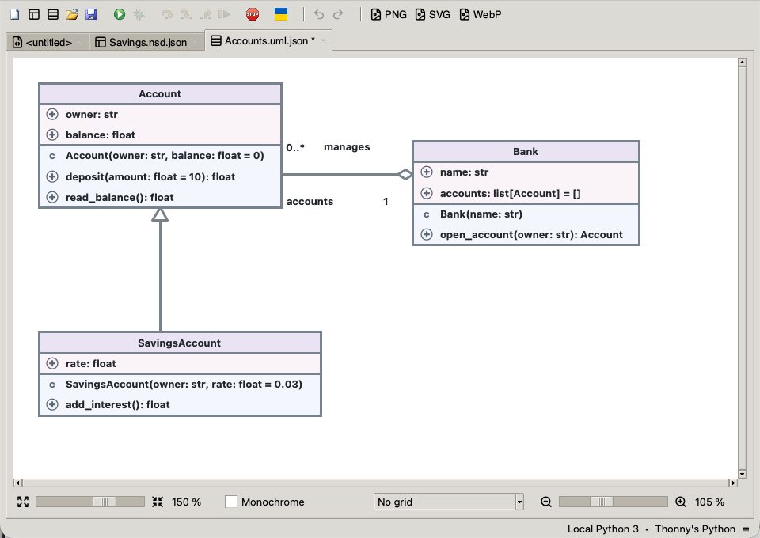
</picture>

*Links steht die Gestaltung auf 150 %, rechts der Ansichtszoom auf 105 %. Das Raster wählst du in der Mitte.*

### Helle oder dunkle Darstellung wählen

Öffne `Werkzeuge → Optionen → Thonny SE` und wähle unter `Darstellung` zwischen `Hell` und `Dunkel`. Beiden Einstellungen kannst du ein Thonny-Oberflächen- und ein Syntax-Theme zuordnen. Beim Bestätigen wechseln Thonny und die Diagrammansichten. `Monochrom` ist in beiden Darstellungen direkt im Diagrammeditor verfügbar.

### Ein Diagramm als Bild exportieren

Klicke oben auf `PNG`, `SVG` oder `WebP`. Alternativ findest du unter `Datei → Grafik exportieren als …` dieselbe Auswahl. Das funktioniert für beide Diagrammarten gleich.

<picture>
  <source media="(prefers-color-scheme: dark)" srcset="images/manual/export-buttons-dark.png">
  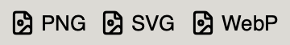
</picture>

*Hier wählst du das Bildformat.*

Bei PNG und WebP stellst du die Bildgröße ein. Einen transparenten Hintergrund kannst du in allen drei Formaten wählen. Mit `Monochrom` kannst du auch die Flächen von Bausteinen und Klassenkarten transparent machen. Bei ausgeschaltetem `Monochrom` wählst du für die Ausgabedatei `Hell` oder `Dunkel`. Diese Einstellungen sind unabhängig von der Diagrammansicht. Bestätige mit `OK` und wähle den Speicherort.

<picture>
  <source media="(prefers-color-scheme: dark)" srcset="images/manual/export-dark.png">
  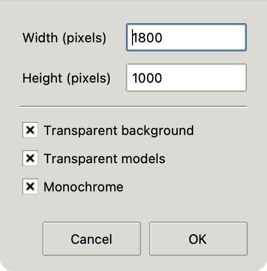
</picture>

*Die Größe wird in Pixeln angegeben. Die Optionen gelten für den Export.*

## 2. Struktogramme

### Einen Ablauf aufbauen

Wähle einen Baustein aus der Palette links. Füge ihn an der gewünschten Stelle ein. Verschachtle Verzweigungen und Schleifen, um deinen Ablauf aufzubauen.

Text ändern? Doppelklick auf den Baustein. Verschieben oder weitere Aktionen? Ziehen beziehungsweise Rechtsklick auf den Baustein.

<picture>
  <source media="(prefers-color-scheme: dark)" srcset="images/manual/structogram-dark.png">
  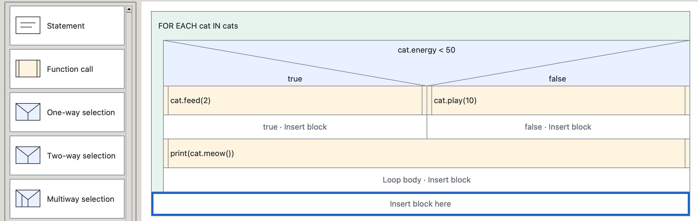
</picture>

*Links findest du die Bausteine. Die Einfügeflächen im Diagramm zeigen dir, wo weitere Bausteine Platz haben.*

### Zwischen einfacher und erweiterter Palette wechseln

Nutze den Pfeil am unteren Rand der Palette. Die einfache Palette bietet eine reduzierte Auswahl. Aufgeklappt stehen dir weitere Bausteine zur Verfügung. Dein Entwurf bleibt beim Wechsel erhalten.

<picture>
  <source media="(prefers-color-scheme: dark)" srcset="images/manual/palette-switch-dark.png">
  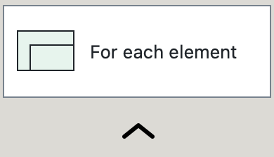
</picture>

*Der Pfeil klappt die zusätzlichen Bausteine auf oder zu.*

### Struktogramm und Python ineinander übertragen

Struktogramm zu Python: Wähle im Kontextmenü `Code aus Struktogramm` oder `Code aus Auswahl`.

Python zu Struktogramm: Klicke im Python-Editor mit rechts. Wähle die Übernahme der ganzen Datei oder deiner Textauswahl als Struktogramm.

Danach bearbeitest du Diagramm und Python-Dokument jeweils für sich. Starte die Übertragung erneut, wenn du einen neuen Stand übernehmen möchtest. Nicht strukturell darstellbarer Python-Code bleibt beim Import als Codeblock erhalten.

### Bausteine vorübergehend auslassen

Wähle die Bausteine aus und nutze im Kontextmenü `Deaktivieren`. Sie bleiben im Entwurf sichtbar. Beim Erzeugen von Python-Code und beim Grafikexport werden sie ausgelassen. Mit `Aktivieren` nimmst du sie wieder dazu.

Anweisungstexte dürfen auch Pseudocode sein. Beim Python-Export werden daraus Kommentare, wenn sie keine gültigen Python-Anweisungen sind. Bedingungen und Schleifenausdrücke müssen für den Codeexport gültige Python-Ausdrücke sein.

Importierst du Python-Code mit `try`, kann Thonny SE auch `except`, `else` und `finally` darstellen. Diesen Baustein gibt es nicht in der Palette. Sein Info-Symbol erklärt, dass die Darstellung eine Erweiterung des üblichen Struktogramms ist.

## 3. UML-Klassen

### Klassen und Beziehungen anlegen

Klicke auf die freie Fläche mit rechts und lege eine `Neue Klasse` an. Attribute beschreiben die Daten eines Objekts, Methoden sein Verhalten.

Über das Kontextmenü einer Klasse ergänzt du Beziehungen. Wähle die passende Beziehungsart und die beteiligte Klasse. Rollen und Kardinalitäten/Multiplizitäten beschreiben die Verbindung genauer. Kommentare kannst du über das Kontextmenü ergänzen.

<picture>
  <source media="(prefers-color-scheme: dark)" srcset="images/manual/classes-dark.png">
  
</picture>

*`CatShelter` hält eine Sammlung von `Cat`-Objekten. Die Beziehung trägt den Rollennamen `cats` und die Kardinalität/Multiplizität `0..*`.*

### Attribute, Methoden und Parameter bearbeiten

Öffne den gewünschten Eintrag mit einem Doppelklick. Ergänze Namen, Typen und bei Bedarf Start- oder Standardwerte. Neue Einträge ergänzt du über das Kontextmenü (`Attribut hinzufügen` oder `Methode hinzufügen`) oder die Plus-Schaltflächen rechts an der ausgewählten Klasse.

Bei einer Methode hat jeder Parameter eine eigene Zeile. Bestätige deine Bearbeitung mit dem Häkchen. Mit <kbd>Esc</kbd> brichst du sie ab.

Thonny SE kann beim Auswählen eines Attributtyps einen passenden Startwert vorschlagen. Außerdem kann es prüfen, ob Startwerte und Parameter-Standardwerte zu den angegebenen Typen passen. Ungültige Werte werden rot markiert und blockieren die Übernahme. Beide Einstellungen findest du in den Optionen von Thonny SE im Bereich für den UML-Editor.

<picture>
  <source media="(prefers-color-scheme: dark)" srcset="images/manual/edit-method-dark.png">
  
</picture>

*Hier wird `feed` mit `portions`, `food` und `fresh_water` bearbeitet. Typen und Standardwerte stehen direkt neben den Parametern.*

### Klassen am Raster ausrichten

Wähle unten im UML-Editor den gewünschten Rastermodus. Ein sichtbares Raster hilft beim Ausrichten. Das magnetische Raster lässt Klassen beim Verschieben einrasten. Ohne Raster kannst du sie frei platzieren.

*Die Rasterauswahl liegt zwischen Gestaltung und Zoom; die aktuelle Leiste siehst du oben unter „Speichern und den Überblick behalten“.*

### Einstellungen für deinen Unterricht

Unter `Werkzeuge → Optionen → Thonny SE` passt du die Eingabehilfen an:

- **Anfangswerte:** Beim Auswählen eines Attributtyps wird zum Beispiel `0` für `int`, `0.0` für `float`, `""` für `str` oder `[]` für eine Liste eingetragen. Die Funktion ist standardmäßig an.
- **Typnamen und Werte:** Zwei getrennte Prüfungen helfen bei unbekannten Typnamen und unpassenden Anfangs- oder Parameter-Standardwerten. Beide sind standardmäßig an.
- **Methodennamen:** Automatisch erzeugte Getter und Setter verwenden standardmäßig `snake_case`. Du kannst `camelCase` wählen. Vorhandene Methodennamen bleiben erhalten.
- **Beziehungsangaben:** Standardmäßig heißen sie Kardinalitäten. Du kannst die Bezeichnung auf Multiplizitäten umstellen.
- **Objektbank:** Methoden sind standardmäßig als Schaltflächen sichtbar. Auf Wunsch verwendest du die Auswahlliste. Die zusätzliche Typprüfung für Aufrufargumente ist standardmäßig an.

<picture>
  <source media="(prefers-color-scheme: dark)" srcset="images/manual/options-dark.png">
  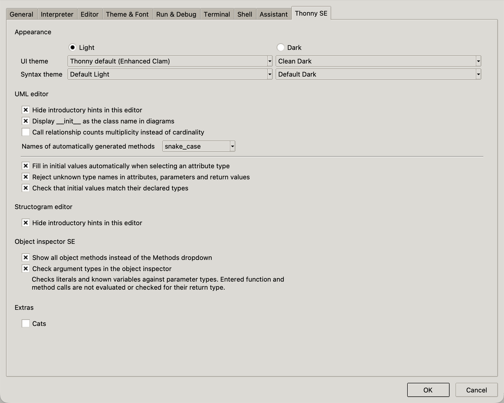
</picture>

*Wähle die Eingabehilfen, die zu deiner Arbeit passen.*

## 4. Objektbank

### Objekte instanziieren

1. Öffne `Ansicht → Objektinspektor SE`.
2. Drücke im UML-Tab <kbd>F5</kbd>, um den aktuellen Entwurf auszuführen.
3. Klicke die gewünschte Klasse rechts an und wähle `Objekte instanziieren …`.
4. Gib einen Objektnamen und die benötigten Parameter ein.
5. Klicke auf `Instanziieren`. Unten erscheint das neue Objekt mit Name und Klasse.

Du kannst auch direkt in der Objektbank rechtsklicken und unter `Objekt instanziieren` die gewünschte Klasse wählen. Das Diagramm muss dafür bereits ausgeführt sein.

Der Dialog bleibt offen. Du kannst gleich das nächste Objekt erzeugen. Ein neuer freier Name wird vorgeschlagen. Mit `Schließen` gehst du zurück zum Diagramm.

> Du brauchst dafür noch keine eigene Python-Datei.

Der vorgeschlagene Objektname verwendet `snake_case`, zum Beispiel `cat_shelter1`. Du darfst ihn ändern. Führende Unterstriche sind erlaubt. Der Name muss ein gültiger, noch nicht belegter Python-Name sein. Ein Schlüsselwort wie `class` ist kein Objektname.

Braucht der Konstruktor Parameter, steht unter dem Namen seine Python-Signatur `__init__(...)`. Hier heißt er immer so, auch wenn die Klassenkarte ihn mit dem Klassennamen anzeigt.

<picture>
  <source media="(prefers-color-scheme: dark)" srcset="images/manual/instantiate-dark.png">
  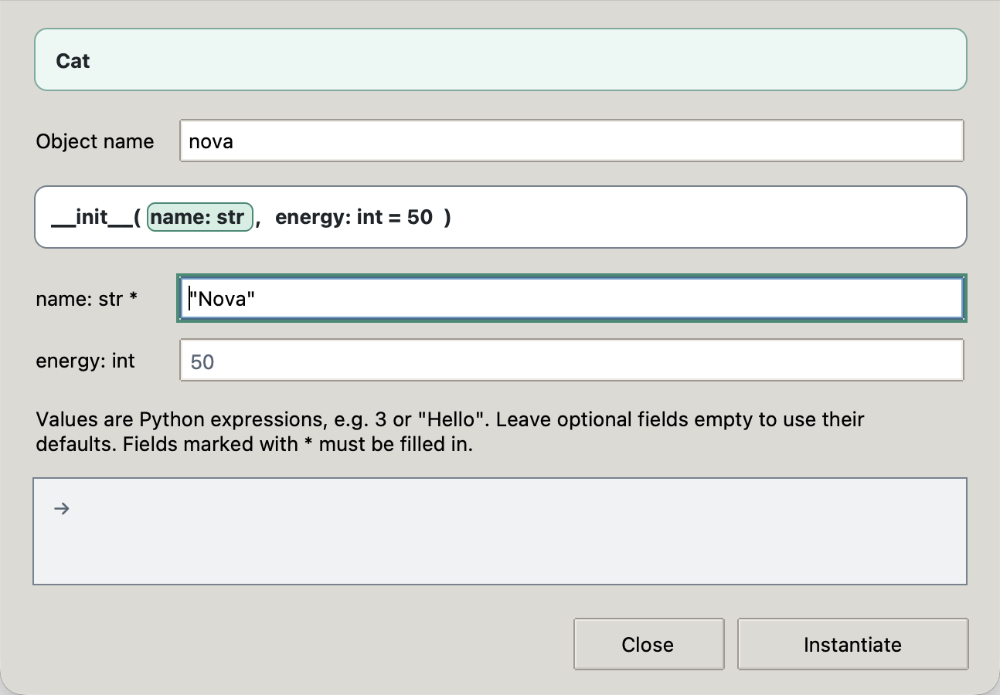
</picture>

*`Nova` bekommt einen Namen. Für `energy` gilt der Standardwert `50`, solange das Feld leer bleibt.*

### Parameter eingeben

Schreibe die Werte so, wie du sie in Python verwenden würdest:

| Du brauchst … | Beispiel |
| --- | --- |
| eine ganze Zahl | `2` |
| einen Text | `"tuna"` |
| eine Liste ganzer Zahlen | `[2, 4, 6]` oder `[]` |
| ein vorhandenes Objekt | `luna` |

Ein grauer Wert im leeren Feld zeigt den Standardwert. Du musst ihn nicht noch einmal eingeben. Bei einer Pflichtangabe steht ein `*` am Feldnamen.

| Markierung | Bedeutung |
| --- | --- |
| Gelb | Eine Pflichtangabe fehlt. |
| Grün | Du bearbeitest gerade dieses Feld. Auch der Parameter in der Signatur wird hervorgehoben. |
| Rot | Die Eingabe ist ungültig oder passt bei eingeschalteter Typprüfung nicht zum verlangten Typ. |

Solange eine Pflichtangabe fehlt oder eine Eingabe ungültig ist, bleibt die Aufrufschaltfläche gesperrt. Die Markierung aktualisiert sich beim Tippen.

Die Typprüfung für die Objektbank ist standardmäßig eingeschaltet. Sie prüft Literale wie `[2, 4, 6]` und bereits bekannte Variablen. Eingetippte Funktions- und Methodenaufrufe werden dabei nicht ausgeführt und ihre Rückgabetypen nicht vorab geprüft. Die Einstellung gilt für Konstruktoren und Methoden.

<picture>
  <source media="(prefers-color-scheme: dark)" srcset="images/manual/method-validation-dark.png">
  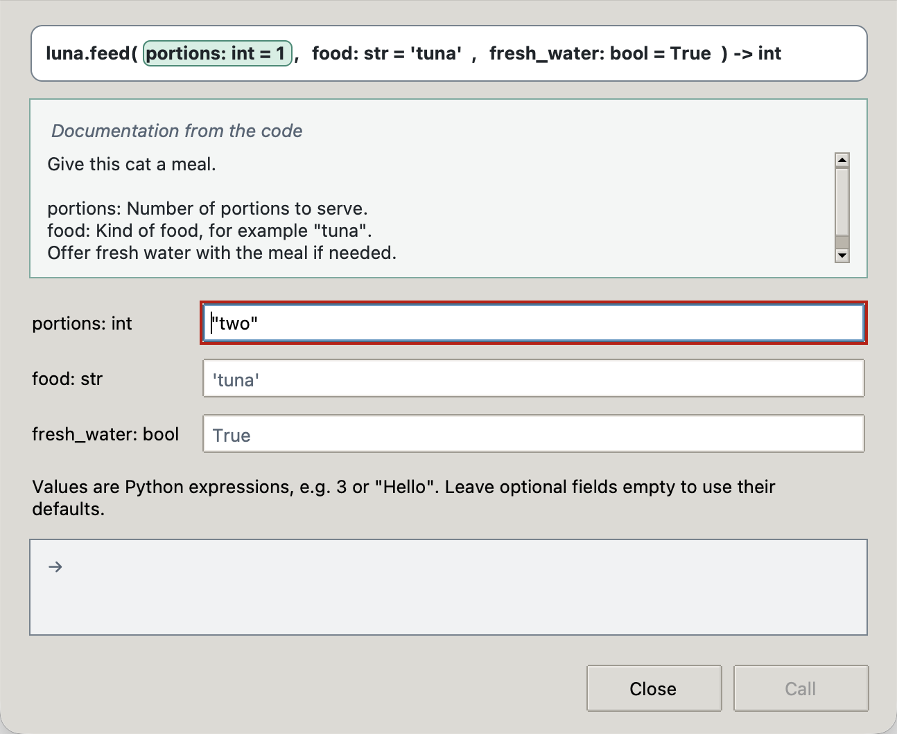
</picture>

*`"two"` ist ein Text. Für `portions: int` wird eine ganze Zahl erwartet.*

### Die Objektbank aufräumen

Ziehe Objektkarten an die gewünschte Stelle. Über das Kontextmenü kannst du sie auch verschieben, einklappen oder entfernen. Entfernen löst den Namen des Objekts; Verweise aus anderen Objekten bleiben erhalten. Reihenfolge und eingeklappte Karten gelten für die aktuelle Sitzung.

### Werte ansehen und Methoden aufrufen

Die Objektkarte zeigt dir Namen, Klasse und Attributwerte. Darunter stehen die Methoden als Schaltflächen. In den Optionen kannst du stattdessen die Auswahlliste wählen.

Klappe den Pfeil vor einer Sammlung oder einem Unterobjekt auf, um weiter hineinzuschauen. Unterobjekte bleiben in derselben Objektbank. Du kannst auch ihre Methoden aufrufen. Wählst du eine Sammlung aus, werden ihre direkt enthaltenen Objekte in der Objektbank hervorgehoben.

<picture>
  <source media="(prefers-color-scheme: dark)" srcset="images/manual/objects-dark.png">
  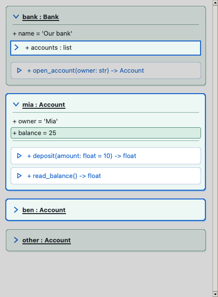
</picture>

*Die ausgewählte Sammlung `bank.accounts` hebt die Konten `mia` und `ben` hervor. `ben` und `other` sind eingeklappt.*

Klicke auf eine Methode, gib ihre Parameter ein und wähle `Aufrufen`. Die Beschreibung im Dialog stammt aus der Dokumentation im Python-Code. Beim Wechsel des Eingabefelds folgt die Markierung in der Signatur.

Die Rückgabe steht hinter `→`. Eine erfolgreiche Rückgabe erscheint grün. Gibt die Methode keinen Wert zurück, steht dort `None`. Das ist kein Fehler. Ausgaben mit `print()` erscheinen in Thonnys Konsole.

<picture>
  <source media="(prefers-color-scheme: dark)" srcset="images/manual/method-call-dark.png">
  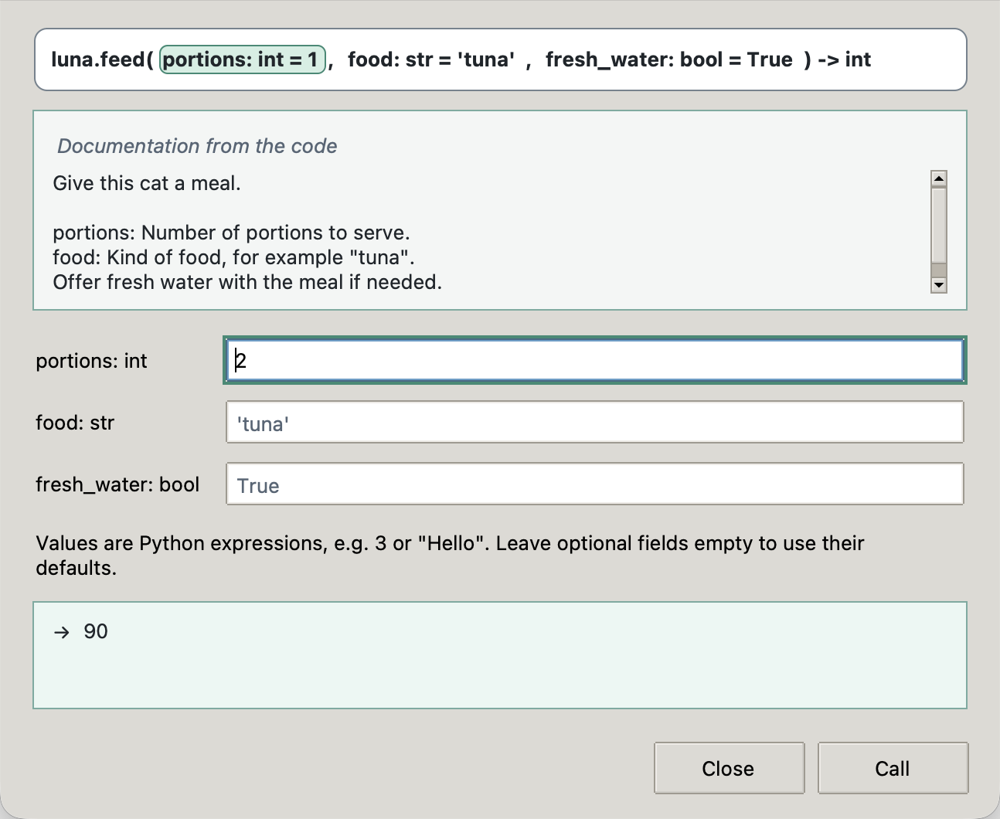
</picture>

*Nach `feed` hat Luna mehr Energie. Die Methode gibt den neuen Energiewert zurück.*

Du kannst den Dialog vergrößern. Eingabefelder, Beschreibung und Ausgabe nutzen den zusätzlichen Platz. Lange Texte lassen sich scrollen. Die Schriftgröße bleibt gleich.

Schlägt die Ausführung fehl, wird die Ausgabefläche rot. Der Dialog verweist auf die Konsole. Dort steht die vollständige Python-Fehlermeldung.

<picture>
  <source media="(prefers-color-scheme: dark)" srcset="images/manual/method-error-dark.png">
  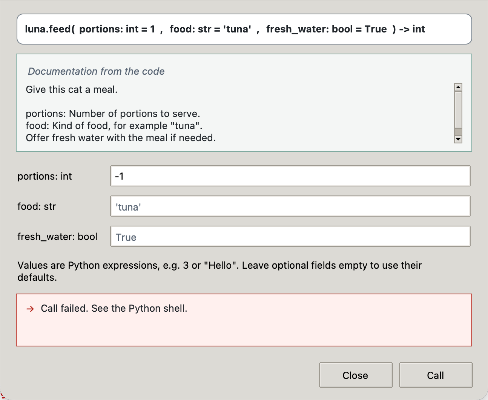
</picture>

*Ein gültiger Datentyp garantiert noch keinen erfolgreichen Aufruf. Hier lehnt der Python-Code eine negative Portionszahl ab.*

### Mit zurückgegebenen Objekten weiterarbeiten

Gibt eine Methode ein Objekt oder eine Sammlung zurück, kannst du das Ergebnis mit `Objekt übernehmen …` unter einem eigenen Namen in die Objektbank aufnehmen. Du arbeitest mit derselben Rückgabe weiter – die Methode wird dafür nicht erneut aufgerufen.

<picture>
  <source media="(prefers-color-scheme: dark)" srcset="images/manual/keep-object-dark.png">
  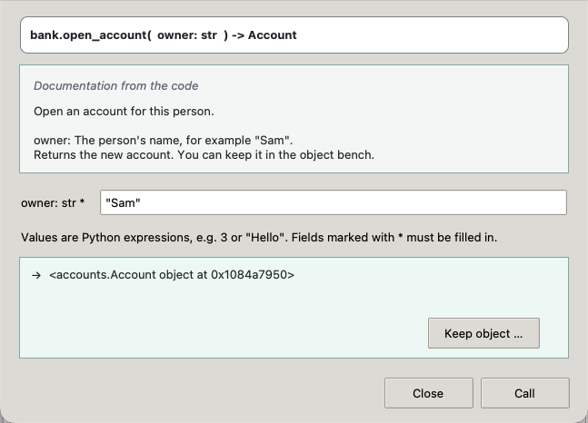
</picture>

*`bank.open_account` gibt das neue Konto zurück. Mit `Keep object …` nimmst du es in die Objektbank auf.*

### Einen laufenden Aufruf beenden

Während ein Aufruf läuft, wird aus `Schließen` die Schaltfläche `Unterbrechen`. Klicke darauf, wenn du ihn stoppen möchtest.

Läuft der Aufruf weiter, erscheint nach etwa zwei Sekunden `Python-Sitzung beenden`. Diese Aktion beendet den Interpreter und entfernt alle bisherigen Objekte. Führe das Diagramm anschließend erneut aus, wenn du weiterarbeiten möchtest. Das gilt auch für einen laufenden Konstruktor.

<picture>
  <source media="(prefers-color-scheme: dark)" srcset="images/manual/method-stop-dark.png">
  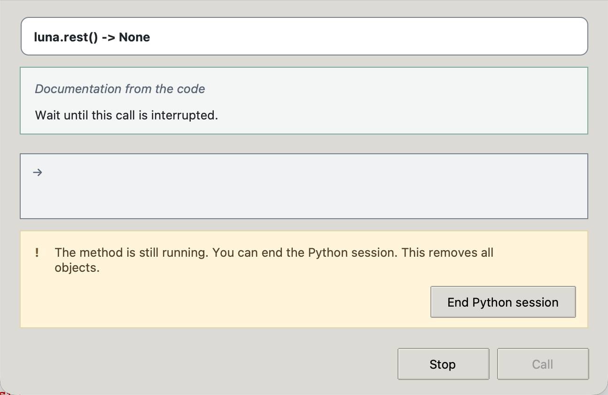
</picture>

*Unterbrechen reicht nicht immer. Mit dem vollständigen Sitzungsende bekommst du wieder einen frischen Interpreter.*

### Nach einer Änderung neu starten

Änderst du etwas am Diagramm, das den Code beeinflusst, werden vorhandene Objekte nicht nachträglich umgebaut. Sie bleiben mit ihren bisherigen Methoden verfügbar. Ein Hinweis zeigt dir, dass Diagramm und geladenes Programm auseinanderliegen. Für neue Objekte ist ein neuer Lauf nötig. Bloßes Verschieben einer Klassenkarte erfordert keinen Neustart.

Drücke im UML-Tab erneut <kbd>F5</kbd>, um den aktuellen Entwurf zu laden. Dabei werden die bisherigen Objekte entfernt.

### Wenn Diagramm und Python-Dateien auseinanderliegen

Sind Klassen mit Python-Dateien verknüpft, prüft Thonny SE sie vor dem Diagrammlauf.

**Die Inhalte unterscheiden sich:** Der Dialog nennt Dateien und betroffene Klassen. Mit `Abgleich durchführen …` öffnest du den Abgleich. Mit `Dennoch ausführen` verwendest du die sichtbare Klassenstruktur zusammen mit dem vorhandenen Methodencode aus den Python-Dateien. Mit `Abbrechen` bleibt die bisherige Sitzung erhalten.

<picture>
  <source media="(prefers-color-scheme: dark)" srcset="images/manual/run-different-dark.png">
  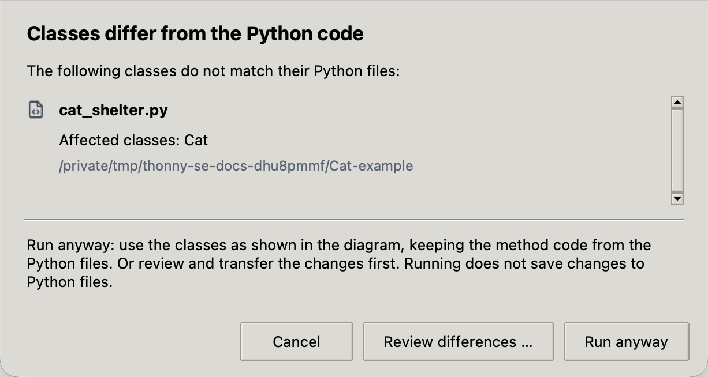
</picture>

**Eine Datei ist nicht erreichbar:** Mit `Mit Modell arbeiten` kannst du vorläufig die betroffenen Klassen aus dem Diagramm verwenden. Der Methodencode aus den fehlenden Dateien steht dann nicht zur Verfügung. Die Dateizuordnungen bleiben erhalten. Oder du brichst ab und ordnest die Dateien zuerst neu zu.

<picture>
  <source media="(prefers-color-scheme: dark)" srcset="images/manual/run-missing-dark.png">
  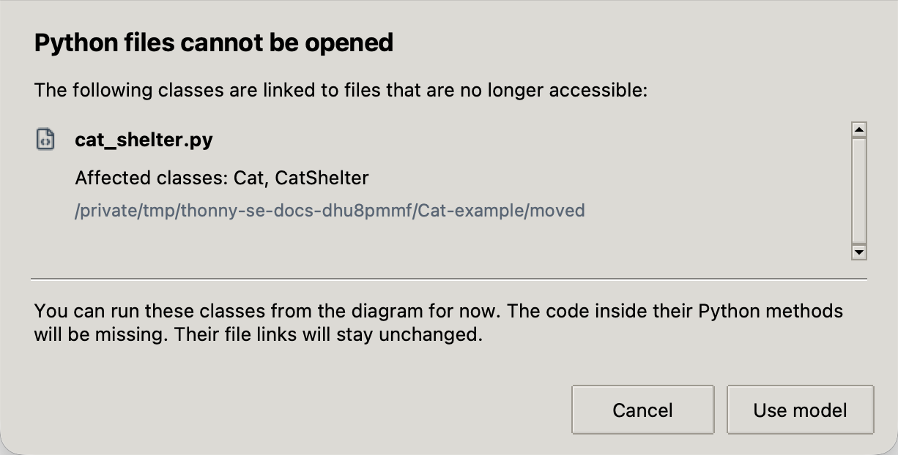
</picture>

## 5. Modell und Code

### Code erzeugen oder einlesen

Vom Modell zum Code: Wähle im Kontextmenü `Code aus Klasse` oder `Code aus Diagramm`. Wähle im Speicherdialog den Dateinamen. Die neue Python-Datei wird gespeichert und geöffnet. Ergänze dort die Methodenrümpfe.

Vom Code zum Modell: Übernimm Klassen aus dem aktuellen Python-Editor oder über `Klassen aus dem Dateisystem …` aus Python-Dateien. So bekommst du eine grafische Sicht auf vorhandenen Code.

### Eine oder mehrere Python-Dateien verwenden

Ein Diagramm muss nicht genau einer Python-Datei entsprechen. Mehrere Klassen können gemeinsam in einer Datei stehen. Sie können auch auf mehrere Dateien verteilt sein und trotzdem im selben Diagramm erscheinen.

<picture>
  <source media="(prefers-color-scheme: dark)" srcset="images/manual/one-file-dark.png">
  
</picture>

*Hier stehen beide Klassen in `cat_shelter.py`. Du kannst sie gemeinsam im Diagramm zeigen.*

Die Quellenzuordnung hält für jede verknüpfte Klasse fest, wo ihr Code liegt. Bei mehreren Dateien behält jede Klasse ihre eigene Zuordnung. Über `Zur Stelle im Code` springst du zur passenden Definition.

Speichere Diagramm und zugehörige Python-Dateien, damit du später mit demselben Stand weiterarbeiten kannst. Wurde eine verknüpfte Datei verschoben oder umbenannt, erscheint beim Abgleich ein Hinweis. Über `Python-Quelldatei neu zuordnen …` wählst du sie erneut aus.

### Änderungen abgleichen

Starte im Kontextmenü den Abgleich `aus Code` oder `in den Code` für die gewünschte Klasse oder das Diagramm. Die Vorschau zeigt Quelle und Ziel.

Übernehmbare Änderungen sind bereits ausgewählt, auch Löschungen. Konflikte sind nicht vorausgewählt. Prüfe die Vorschläge, wähle bei Bedarf Einträge ab und bestätige mit `OK`. Sind mehrere Dateien beteiligt, gruppiert die Vorschau die Änderungen nach Python-Datei. Vorhandene Methodenimplementierungen bleiben beim Aktualisieren der Signaturen erhalten. Betroffene Python-Dateien werden im Editor geöffnet. Der Abgleich speichert sie nicht automatisch. Speichere die geänderten Dokumente anschließend selbst; der Stern im Tab erinnert dich daran.

<picture>
  <source media="(prefers-color-scheme: dark)" srcset="images/manual/apply-changes-dark.png">
  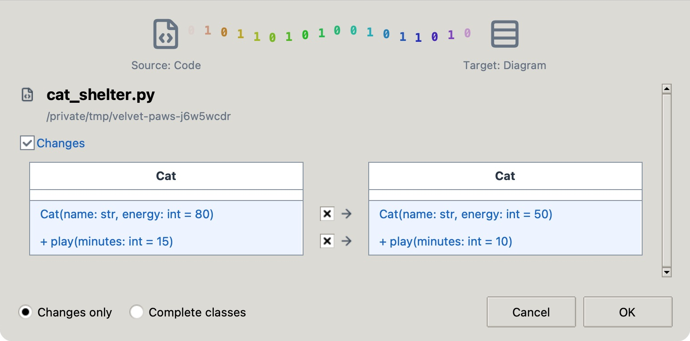
</picture>

*Links steht der eingelesene Code, rechts das bisherige Diagramm. Die Häkchen wählen aus, welche Änderungen übernommen werden.*

### Speichern, übertragen oder ausführen?

| Du möchtest … | Dafür nutzt du … |
| --- | --- |
| dein Diagramm oder deinen Code aufbewahren | `Speichern` im jeweiligen Dokument |
| Änderungen zwischen Modell und Python übernehmen | den Codeabgleich mit Vorschau |
| den aktuellen UML-Entwurf mit Objekten ausprobieren | `Ausführen` / <kbd>F5</kbd> im UML-Tab |

Eine Änderung am Diagramm wird nicht automatisch in jede Python-Datei und jedes vorhandene Objekt übernommen. Du entscheidest, wann du abgleichst und wann du neu ausführst.
