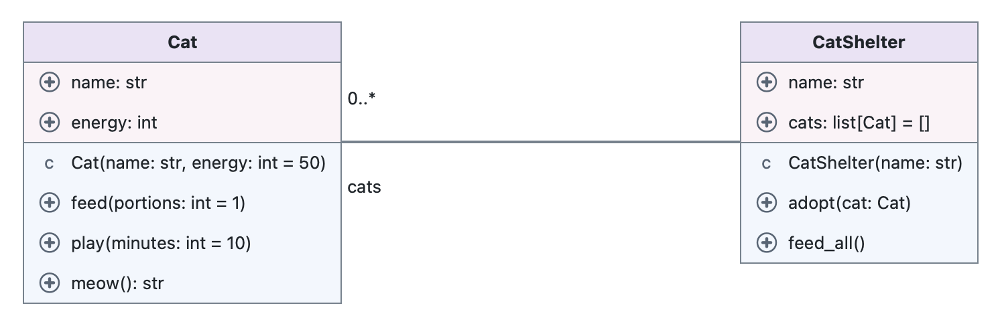
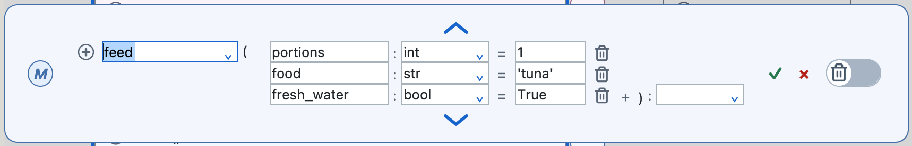
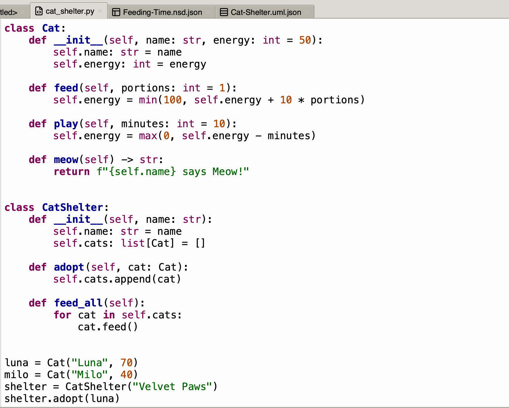

# Thonny SE – Manual

[English](MANUAL.md) · Deutsch

Was möchtest du machen? Springe zur passenden Aufgabe. Die Bilder zeigen die englische Oberfläche. Die Schritte nennen die deutschen Befehle.

## Schnell finden

| Bereich | Ich möchte … |
| --- | --- |
| Einstieg | [ein Diagramm öffnen](#ein-diagramm-anlegen) · [etwas bearbeiten](#etwas-bearbeiten) · [speichern oder zoomen](#speichern-und-den-überblick-behalten) · [die Darstellung wechseln](#helle-oder-dunkle-darstellung-wählen) · [ein Bild exportieren](#ein-diagramm-als-bild-exportieren) |
| Struktogramme | [einen Ablauf aufbauen](#einen-ablauf-aufbauen) · [mehr Bausteine anzeigen](#zwischen-einfacher-und-erweiterter-palette-wechseln) · [Python übertragen](#struktogramm-und-python-ineinander-übertragen) |
| UML | [Klassen anlegen](#klassen-und-beziehungen-anlegen) · [Attribute und Methoden bearbeiten](#attribute-methoden-und-parameter-bearbeiten) · [das Raster nutzen](#klassen-am-raster-ausrichten) |
| Objektbank | [ein Objekt erzeugen](#ein-objekt-erzeugen) · [Werte und Methoden ausprobieren](#werte-ansehen-und-methoden-aufrufen) · [nach Änderungen neu starten](#nach-einer-änderung-neu-starten) |
| Modell und Code | [Code erzeugen oder einlesen](#code-erzeugen-oder-einlesen) · [eine oder mehrere Dateien verwenden](#eine-oder-mehrere-python-dateien-verwenden) · [Änderungen abgleichen](#änderungen-abgleichen) · [Speichern und Ausführen unterscheiden](#speichern-übertragen-oder-ausführen) |

## 1. Einstieg

### Ein Diagramm anlegen

Wähle unter `Datei` ein `neues Struktogramm` oder ein `neues UML-Diagramm`. Ein gespeichertes Diagramm öffnest du wie andere Dateien in Thonny.

### Etwas bearbeiten

> Rechtsklick zeigt dir, was geht. Doppelklick öffnet die Bearbeitung.

Klicke den Baustein, die Klasse oder die Beziehung an, um die es geht. Für neue Elemente klickst du mit rechts auf die freie Diagrammfläche oder eine passende Einfügestelle.

### Speichern und den Überblick behalten

Speichere dein Diagramm wie andere Dokumente in Thonny. Mit Rückgängig nimmst du Bearbeitungsschritte zurück.

Nutze den Zoomregler oder <kbd>Strg</kbd> + Mausrad, auf dem Mac <kbd>Command</kbd> + Mausrad. So zoomst du an der Stelle unter dem Mauszeiger. Große Diagramme kannst du horizontal und vertikal scrollen.

### Helle oder dunkle Darstellung wählen

Öffne `Werkzeuge → Optionen → Thonny SE` und wähle unter `Darstellung` zwischen `Hell` und `Dunkel`. Beiden Einstellungen kannst du ein Thonny-Oberflächen- und ein Syntax-Theme zuordnen. Beim Bestätigen wechseln Thonny und die Diagrammansichten. `Monochrom` ist in beiden Darstellungen direkt im Diagrammeditor verfügbar.

### Ein Diagramm als Bild exportieren

Klicke oben auf `PNG`, `SVG` oder `WebP`. Alternativ findest du unter `Datei → Grafik exportieren als …` dieselbe Auswahl. Das funktioniert für beide Diagrammarten gleich.

<picture>
  <source media="(prefers-color-scheme: dark)" srcset="images/manual/export-buttons-dark.png">
  
</picture>

*Hier wählst du das Bildformat.*

Bei PNG und WebP stellst du die Bildgröße ein. Einen transparenten Hintergrund kannst du in allen drei Formaten wählen. Mit `Monochrom` kannst du auch die Flächen von Bausteinen und Klassenkarten transparent machen. Bei ausgeschaltetem `Monochrom` wählst du für die Ausgabedatei `Hell` oder `Dunkel`. Diese Einstellungen sind unabhängig von der Diagrammansicht. Bestätige mit `OK` und wähle den Speicherort.

<picture>
  <source media="(prefers-color-scheme: dark)" srcset="images/manual/export-dark.png">
  
</picture>

*Die Größe wird in Pixeln angegeben. Die Optionen gelten für den Export.*

## 2. Struktogramme

### Einen Ablauf aufbauen

Wähle einen Baustein aus der Palette links. Füge ihn an der gewünschten Stelle ein. Verschachtle Verzweigungen und Schleifen, um deinen Ablauf aufzubauen.

Text ändern? Doppelklick auf den Baustein. Verschieben oder weitere Aktionen? Ziehen beziehungsweise Rechtsklick auf den Baustein.

<picture>
  <source media="(prefers-color-scheme: dark)" srcset="images/manual/structogram-dark.png">
  
</picture>

*Links findest du die Bausteine. Die Einfügeflächen im Diagramm zeigen dir, wo weitere Bausteine Platz haben.*

### Zwischen einfacher und erweiterter Palette wechseln

Nutze den Pfeil am unteren Rand der Palette. Die einfache Palette bietet eine reduzierte Auswahl. Aufgeklappt stehen dir weitere Bausteine zur Verfügung. Dein Entwurf bleibt beim Wechsel erhalten.

<picture>
  <source media="(prefers-color-scheme: dark)" srcset="images/manual/palette-switch-dark.png">
  
</picture>

*Der Pfeil klappt die zusätzlichen Bausteine auf oder zu.*

### Struktogramm und Python ineinander übertragen

Struktogramm zu Python: Wähle im Kontextmenü `Code aus Struktogramm` oder `Code aus Auswahl`.

Python zu Struktogramm: Klicke im Python-Editor mit rechts. Wähle die Übernahme der ganzen Datei oder deiner Textauswahl als Struktogramm.

Danach bearbeitest du Diagramm und Python-Dokument jeweils für sich. Starte die Übertragung erneut, wenn du einen neuen Stand übernehmen möchtest. Nicht strukturell darstellbarer Python-Code bleibt beim Import als Codeblock erhalten.

## 3. UML-Klassen

### Klassen und Beziehungen anlegen

Klicke auf die freie Fläche mit rechts und lege eine `Neue Klasse` an. Attribute beschreiben die Daten eines Objekts, Methoden sein Verhalten.

Über das Kontextmenü einer Klasse ergänzt du Beziehungen. Wähle die passende Beziehungsart und die beteiligte Klasse. Rollen und Kardinalitäten/Multiplizitäten beschreiben die Verbindung genauer. Kommentare kannst du über das Kontextmenü ergänzen.

<picture>
  <source media="(prefers-color-scheme: dark)" srcset="images/manual/classes-dark.png">
  
</picture>

*`CatShelter` hält eine Sammlung von `Cat`-Objekten. Die Beziehung trägt den Rollennamen `cats` und die Kardinalität/Multiplizität `0..*`.*

### Attribute, Methoden und Parameter bearbeiten

Öffne den gewünschten Eintrag mit einem Doppelklick. Ergänze Namen, Typen und bei Bedarf Start- oder Standardwerte. Neue Einträge ergänzt du über das Kontextmenü (`Attribut hinzufügen` oder `Methode hinzufügen`) oder die Plus-Schaltflächen rechts an der ausgewählten Klasse.

Bei einer Methode hat jeder Parameter eine eigene Zeile. Bestätige deine Bearbeitung mit dem Häkchen. Mit <kbd>Esc</kbd> brichst du sie ab.

Thonny SE kann beim Auswählen eines Attributtyps einen passenden Startwert vorschlagen. Außerdem kann es prüfen, ob Startwerte und Parameter-Standardwerte zu den angegebenen Typen passen. Ungültige Werte werden rot markiert und blockieren die Übernahme. Beide Einstellungen findest du in den Optionen von Thonny SE im Bereich für den UML-Editor.

<picture>
  <source media="(prefers-color-scheme: dark)" srcset="images/manual/edit-method-dark.png">
  
</picture>

*Hier wird `feed` mit `portions`, `food` und `fresh_water` bearbeitet. Typen und Standardwerte stehen direkt neben den Parametern.*

### Klassen am Raster ausrichten

Wähle unten im UML-Editor den gewünschten Rastermodus. Ein sichtbares Raster hilft beim Ausrichten. Das magnetische Raster lässt Klassen beim Verschieben einrasten. Ohne Raster kannst du sie frei platzieren.

<picture>
  <source media="(prefers-color-scheme: dark)" srcset="images/manual/grid-zoom-dark.png">
  
</picture>

*Unten im UML-Editor wählst du das Raster. Rechts daneben findest du den Zoom.*

## 4. Objektbank

### Ein Objekt erzeugen

1. Öffne `Ansicht → Objektinspektor SE`.
2. Drücke im UML-Tab <kbd>F5</kbd>, um den aktuellen Entwurf auszuführen.
3. Klicke die gewünschte Klasse rechts an und wähle `Objekt instanziieren …`.
4. Gib die Werte für die benötigten Parameter ein und bestätige.

> Du brauchst dafür keine eigene Python-Datei.

Thonny SE erzeugt intern den Code für die Ausführung. So kannst du bereits die Objektstruktur erkunden. Was eine Methode tatsächlich tun soll, ergänzt du später als Python-Code in ihrem Methodenrumpf.

### Werte ansehen und Methoden aufrufen

Die Objektkarte zeigt dir Namen, Klasse und Attributwerte. Wähle eine Methode, gib die Werte für ihre Parameter ein und rufe sie auf. Nach dem Aufruf werden die Werte aktualisiert. Ausgaben und Fehler findest du auch in Thonnys Shell.

Klappe den Pfeil vor einer Sammlung oder einem Unterobjekt auf, um weiter hineinzuschauen. Je nach Einstellung erscheinen Methoden als Auswahlliste oder einzelne Schaltflächen.

<picture>
  <source media="(prefers-color-scheme: dark)" srcset="images/manual/objects-dark.png">
  
</picture>

*Luna und Milo sind zwei `Cat`-Objekte mit unterschiedlichen Energiewerten. In `shelter` kannst du die Sammlung `cats` aufklappen.*

### Nach einer Änderung neu starten

Eine Diagrammänderung baut vorhandene Objekte nicht nachträglich um. Sie bleiben verfügbar. Ein Hinweis zeigt dir, wenn sie zu einem anderen Programmstand gehören.

Drücke im UML-Tab erneut <kbd>F5</kbd>, um mit dem aktuellen Entwurf neu zu starten. Dabei wird die bisherige Objektsitzung zurückgesetzt.

## 5. Modell und Code

### Code erzeugen oder einlesen

Vom Modell zum Code: Wähle im Kontextmenü `Code aus Klasse` oder `Code aus Diagramm`. Ergänze die Methodenrümpfe im Python-Editor.

Vom Code zum Modell: Übernimm Klassen aus dem aktuellen Python-Editor oder über `Klassen aus dem Dateisystem …` aus Python-Dateien. So bekommst du eine grafische Sicht auf vorhandenen Code.

### Eine oder mehrere Python-Dateien verwenden

Ein Diagramm muss nicht genau einer Python-Datei entsprechen. Mehrere Klassen können gemeinsam in einer Datei stehen. Sie können auch auf mehrere Dateien verteilt sein und trotzdem im selben Diagramm erscheinen.

<picture>
  <source media="(prefers-color-scheme: dark)" srcset="images/manual/one-file-dark.png">
  
</picture>

*Hier stehen beide Klassen in `cat_shelter.py`. Du kannst sie gemeinsam im Diagramm zeigen.*

Die Quellenzuordnung hält für jede verknüpfte Klasse fest, wo ihr Code liegt. Bei mehreren Dateien behält jede Klasse ihre eigene Zuordnung. Über `Zur Stelle im Code` springst du zur passenden Definition.

Speichere Diagramm und zugehörige Python-Dateien, damit du später mit demselben Stand weiterarbeiten kannst. Wurde eine verknüpfte Datei verschoben oder umbenannt, erscheint beim Abgleich ein Hinweis. Über `Python-Quelldatei neu zuordnen …` wählst du sie erneut aus.

### Änderungen abgleichen

Starte im Kontextmenü den Abgleich `aus Code` oder `in den Code` für die gewünschte Klasse oder das Diagramm. Die Vorschau zeigt Quelle und Ziel.

Wähle die Änderungen aus, die du übernehmen möchtest. Kläre angezeigte Konflikte und bestätige mit `OK`. Sind mehrere Dateien beteiligt, gruppiert die Vorschau die Änderungen nach Python-Datei. Vorhandene Methodenimplementierungen bleiben beim Aktualisieren der Signaturen erhalten.

<picture>
  <source media="(prefers-color-scheme: dark)" srcset="images/manual/apply-changes-dark.png">
  
</picture>

*Links steht der eingelesene Code, rechts das bisherige Diagramm. Die Häkchen wählen aus, welche Änderungen übernommen werden.*

### Speichern, übertragen oder ausführen?

| Du möchtest … | Dafür nutzt du … |
| --- | --- |
| dein Diagramm oder deinen Code aufbewahren | `Speichern` im jeweiligen Dokument |
| Änderungen zwischen Modell und Python übernehmen | den Codeabgleich mit Vorschau |
| den aktuellen UML-Entwurf mit Objekten ausprobieren | `Ausführen` / <kbd>F5</kbd> im UML-Tab |

Eine Änderung am Diagramm wird nicht automatisch in jede Python-Datei und jedes vorhandene Objekt übernommen. Du entscheidest, wann du abgleichst und wann du neu ausführst.
