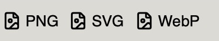
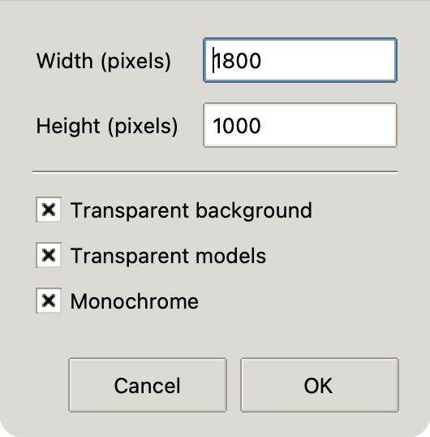
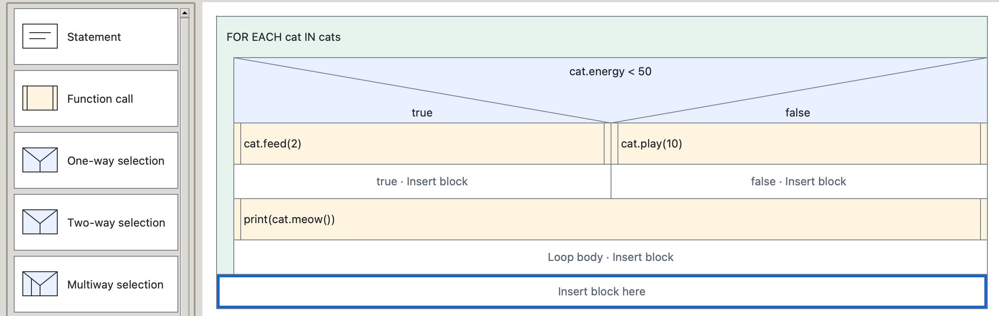
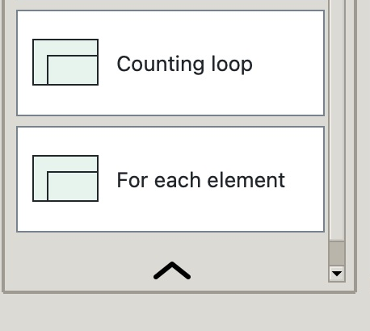
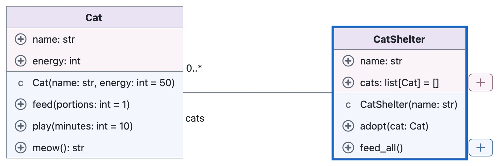
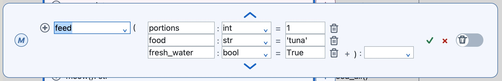
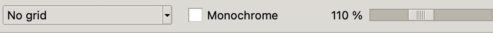
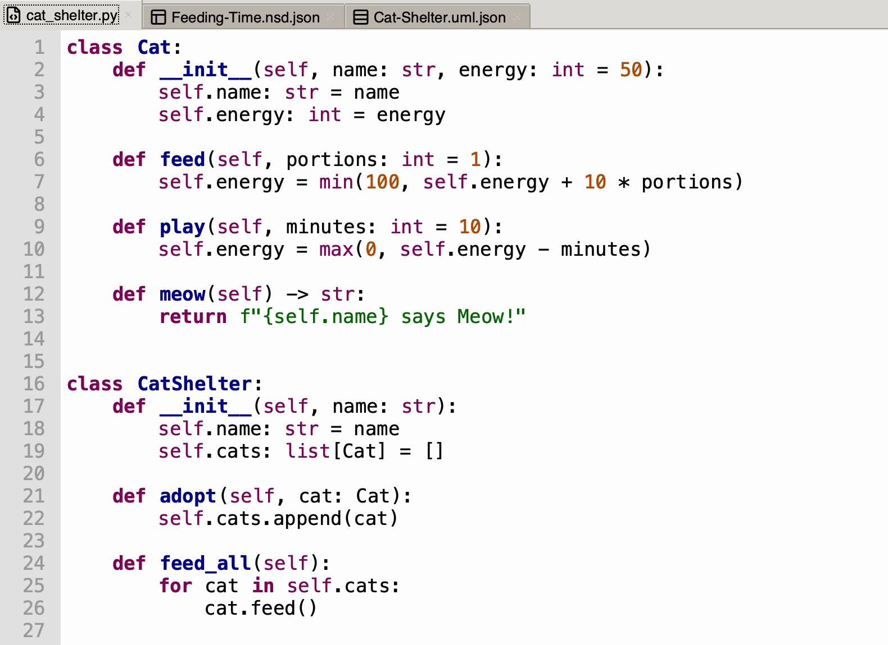

# Thonny SE – Manual

English · [Deutsch](MANUAL.de.md)

What would you like to do? Jump straight to the task you need. The screenshots show the English interface.

## Find it quickly

| Area | I want to … |
| --- | --- |
| Getting started | [create a diagram](#create-a-diagram) · [edit something](#edit-something) · [save or zoom](#save-and-keep-your-bearings) · [export an image](#export-a-diagram-as-an-image) |
| Structograms | [build an algorithm](#build-an-algorithm) · [show more blocks](#switch-between-basic-and-expanded-palettes) · [transfer Python](#transfer-between-structograms-and-python) |
| UML | [create classes](#create-classes-and-relationships) · [edit attributes and methods](#edit-attributes-methods-and-parameters) · [use the grid](#align-classes-with-the-grid) |
| Object bench | [create an object](#create-an-object) · [inspect values and call methods](#inspect-values-and-call-methods) · [restart after changes](#restart-after-a-change) |
| Model and code | [generate or import code](#generate-or-import-code) · [use one or several files](#use-one-or-several-python-files) · [apply changes](#apply-changes) · [understand saving and running](#save-transfer-or-run) |

## 1. Getting started

### Create a diagram

Under `File`, choose `New structogram` or `New UML diagram`. Open a saved diagram like any other file in Thonny.

### Edit something

> Right-click to see what you can do. Double-click to edit.

Click the block, class or relationship you want to change. To add elements, right-click an empty area of the diagram or a suitable insertion point.

### Save and keep your bearings

Save your diagram like other documents in Thonny. Use undo to take back edits.

Use the zoom slider or <kbd>Ctrl</kbd> + mouse wheel, or <kbd>Command</kbd> + mouse wheel on a Mac. This zooms at the point under your pointer. Scroll large diagrams horizontally and vertically.

### Export a diagram as an image

Click `PNG`, `SVG` or `WebP` in the toolbar. You can also find these options under `File → Export image as …`. This works the same way for both diagram types.

*Choose your image format here.*

For PNG and WebP, set the image size next. Choose transparency or monochrome output if needed. Click `OK`, then choose where to save the image.

*Size is given in pixels. These options affect the exported image.*

## 2. Structograms

### Build an algorithm

Choose a block from the palette on the left. Insert it where you need it. Nest branches and loops to build your algorithm.

Change the text? Double-click the block. Move it or find more actions? Drag it or right-click it.

*Find blocks on the left. Insertion areas in the diagram show where more blocks can go.*

### Switch between basic and expanded palettes

Use the arrow at the bottom of the palette. The basic palette offers a reduced selection. Expand it for more block types. Switching keeps your existing design in place.

*The arrow expands or collapses the additional blocks.*

### Transfer between structograms and Python

Structogram to Python: Choose `Code from structogram` or `Code from selection` in the context menu.

Python to structogram: Right-click in the Python editor. Choose to turn the whole file or your text selection into a structogram.

After that, edit the diagram and Python document separately. Start another transfer to bring across a new version. Python code without a structural representation is kept as a code block on import.

## 3. UML classes

### Create classes and relationships

Right-click an empty area and add a `New class`. Attributes describe an object’s data. Methods describe its behaviour.

Add relationships through a class’s context menu. Choose the relationship type and the other class. Roles and multiplicities describe the connection more precisely. Add comments through the context menu.

*`CatShelter` holds a collection of `Cat` objects. The relationship has the role `cats` and multiplicity `0..*`.*

### Edit attributes, methods and parameters

Double-click the entry you want to edit. Add names, types and initial or default values where needed. Add entries through the context menu (`Add attribute` or `Add method`) or the plus buttons to the right of the selected class.

Each method parameter has its own row. Confirm your edit with the check mark. Press <kbd>Esc</kbd> to cancel.

*Editing `feed` with `portions`, `food` and `fresh_water`. Types and default values sit beside each parameter.*

### Align classes with the grid

Choose a grid mode at the bottom of the UML editor. A visual grid helps with alignment. The magnetic grid snaps classes into place as you move them. Choose no grid to position them freely.

*Choose the grid at the bottom of the UML editor. The zoom controls sit to its right.*

## 4. Object bench

### Create an object

1. Open `View → Object inspector SE`.
2. Press <kbd>F5</kbd> in the UML tab to run the current design.
3. Right-click the class you want and choose `Instantiate object …`.
4. Enter the values for the required parameters and confirm.

> You do not need your own Python file for this.

Thonny SE generates the code needed to run the design internally. This lets you explore the object structure straight away. Later, write Python method bodies to give your classes their own behaviour.

### Inspect values and call methods

An object card shows its name, class and attribute values. Choose a method, enter values for its parameters and call it. Values update after the call. Output and errors also appear in Thonny’s Shell.

Expand the arrow beside a collection or nested object to look inside. Depending on your settings, methods appear as a drop-down list or individual buttons.

*Luna and Milo are two `Cat` objects with different energy values. Expand `cats` inside `shelter` to inspect the collection.*

### Restart after a change

Editing a diagram does not rebuild existing objects. They stay available. A hint tells you when they belong to a different program version.

Press <kbd>F5</kbd> again in the UML tab to start with the current design. This resets the previous object session.

## 5. Model and code

### Generate or import code

Model to code: Choose `Code from class` or `Code from diagram` in the context menu. Fill in method bodies in the Python editor.

Code to model: Import classes from the current Python editor or use `Classes from the file system …` to import Python files. This gives you a visual view of existing code.

### Use one or several Python files

A diagram does not have to match exactly one Python file. Several classes can share a file. They can also live in separate files and still appear in the same diagram.

*Both classes live in `cat_shelter.py` here. You can show them together in a diagram.*

A source link records where each linked class’s code lives. With several files, each class keeps its own link. Use `Go to code` to jump to its definition.

Save the diagram and its related Python files so you can return to the same state later.

### Apply changes

Use the context menu to update `from code` or `to code` for a class or the diagram. The preview shows source and target.

Select the changes you want to apply. Resolve any reported conflicts and click `OK`. With several files, changes are grouped by their target files. Existing method implementations are preserved when signatures are updated.

*The imported code is on the left, the existing diagram on the right. Check boxes select which changes to apply.*

### Save, transfer or run?

| You want to … | Use … |
| --- | --- |
| keep your diagram or code | `Save` in that document |
| transfer changes between model and Python | a code update with preview |
| try the current UML design with objects | `Run` / <kbd>F5</kbd> in the UML tab |

A diagram edit does not automatically update every Python file and every existing object. You choose when to apply changes and when to run again.
