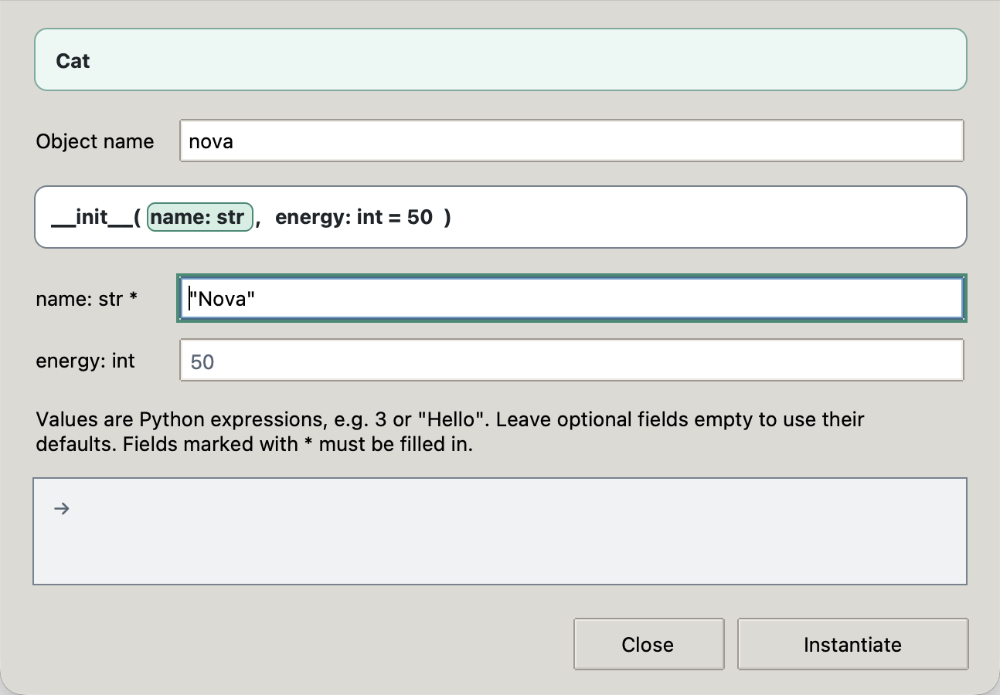
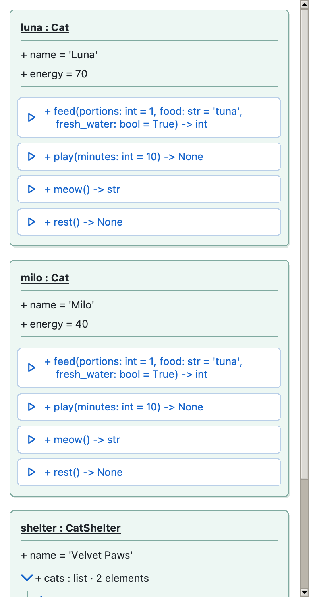
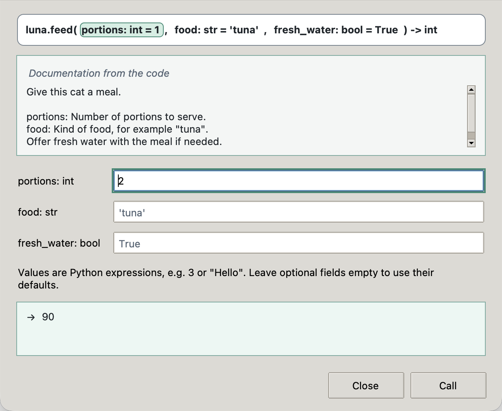
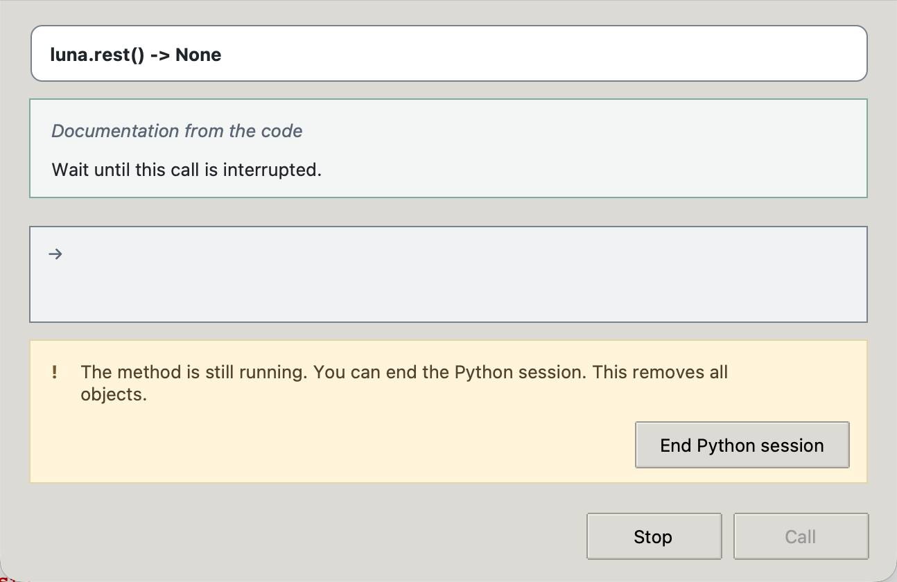
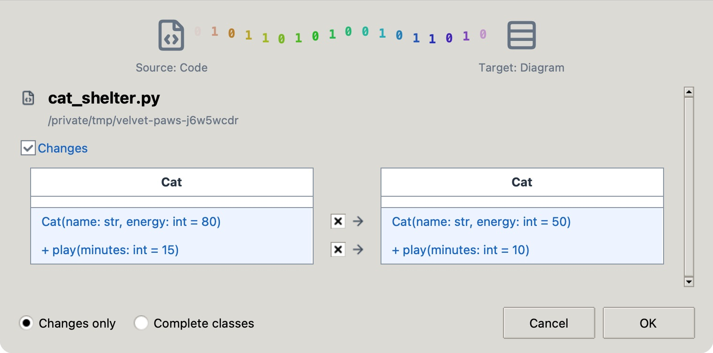

# Thonny SE – Manual

English · [Deutsch](MANUAL.de.md)

What would you like to do? Jump straight to the task you need. The screenshots show the English interface.

## Find it quickly

| Area | I want to … |
| --- | --- |
| Getting started | [create a diagram](#create-a-diagram) · [edit something](#edit-something) · [save or zoom](#save-and-keep-your-bearings) · [change the appearance](#choose-light-or-dark-appearance) · [export an image](#export-a-diagram-as-an-image) |
| Structograms | [build an algorithm](#build-an-algorithm) · [show more blocks](#switch-between-basic-and-expanded-palettes) · [transfer Python](#transfer-between-structograms-and-python) |
| UML | [create classes](#create-classes-and-relationships) · [edit attributes and methods](#edit-attributes-methods-and-parameters) · [use the grid](#align-classes-with-the-grid) · [choose settings](#choose-your-teaching-settings) |
| Object bench | [instantiate objects](#instantiate-objects) · [enter arguments](#enter-arguments) · [call methods](#inspect-values-and-call-methods) · [stop a call](#stop-a-running-call) · [restart after changes](#restart-after-a-change) |
| Model and code | [generate or import code](#generate-or-import-code) · [use one or several files](#use-one-or-several-python-files) · [apply changes](#apply-changes) · [understand saving and running](#save-transfer-or-run) |

## 1. Getting started

### Create a diagram

Under `File`, choose `New structogram` or `New UML diagram`. Open a saved diagram like any other file in Thonny.

### Edit something

> Right-click to see what you can do. Double-click to edit.

Click the block, class or relationship you want to change. To add elements, right-click an empty area of the diagram or a suitable insertion point.

### Save and keep your bearings

Save your diagram like other documents in Thonny. Use undo to take back edits.

Use the zoom slider or <kbd>Ctrl</kbd> + mouse wheel, or <kbd>Command</kbd> + mouse wheel on a Mac. This zooms at the point under your pointer. On a Mac, you can also pinch with two fingers on the trackpad. Scroll large diagrams horizontally and vertically.

### Choose light or dark appearance

Open `Tools → Options → Thonny SE` and choose `Light` or `Dark` under `Appearance`. You can assign a Thonny UI theme and a syntax theme to each setting. Thonny and the diagram views update when you confirm. The `Monochrome` option in each diagram editor is available in both appearances.

### Export a diagram as an image

Click `PNG`, `SVG` or `WebP` in the toolbar. You can also find these options under `File → Export image as …`. This works the same way for both diagram types.

<picture>
  <source media="(prefers-color-scheme: dark)" srcset="images/manual/export-buttons-dark.png">
  
</picture>

*Choose your image format here.*

Set the image size for PNG and WebP. All three formats offer a transparent background. With `Monochrome` on, you can also make the blocks and class cards transparent. With `Monochrome` off, choose `Light` or `Dark` for the exported image. These settings are independent of the diagram view. Click `OK`, then choose where to save the image.

<picture>
  <source media="(prefers-color-scheme: dark)" srcset="images/manual/export-dark.png">
  
</picture>

*Size is given in pixels. These options affect the exported image.*

## 2. Structograms

### Build an algorithm

Choose a block from the palette on the left. Insert it where you need it. Nest branches and loops to build your algorithm.

Change the text? Double-click the block. Move it or find more actions? Drag it or right-click it.

<picture>
  <source media="(prefers-color-scheme: dark)" srcset="images/manual/structogram-dark.png">
  
</picture>

*Find blocks on the left. Insertion areas in the diagram show where more blocks can go.*

### Switch between basic and expanded palettes

Use the arrow at the bottom of the palette. The basic palette offers a reduced selection. Expand it for more block types. Switching keeps your existing design in place.

<picture>
  <source media="(prefers-color-scheme: dark)" srcset="images/manual/palette-switch-dark.png">
  
</picture>

*The arrow expands or collapses the additional blocks.*

### Transfer between structograms and Python

Structogram to Python: Choose `Code from structogram` or `Code from selection` in the context menu.

Python to structogram: Right-click in the Python editor. Choose to turn the whole file or your text selection into a structogram.

After that, edit the diagram and Python document separately. Start another transfer to bring across a new version. Python code without a structural representation is kept as a code block on import.

### Leave blocks out for now

Select the blocks and choose `Deactivate` in the context menu. They stay visible in your design. Python generation and image export leave them out. Choose `Activate` to include them again.

Statements may contain pseudocode. During Python export, text that is not a valid Python statement becomes a comment. Conditions and loop expressions must be valid Python expressions for code export.

When you import Python containing `try`, Thonny SE can also display `except`, `else` and `finally`. This block is not in the palette. Its info symbol explains that the display extends the usual structogram notation.

## 3. UML classes

### Create classes and relationships

Right-click an empty area and add a `New class`. Attributes describe an object’s data. Methods describe its behaviour.

Add relationships through a class’s context menu. Choose the relationship type and the other class. Roles and multiplicities describe the connection more precisely. Add comments through the context menu.

<picture>
  <source media="(prefers-color-scheme: dark)" srcset="images/manual/classes-dark.png">
  
</picture>

*`CatShelter` holds a collection of `Cat` objects. The relationship has the role `cats` and multiplicity `0..*`.*

### Edit attributes, methods and parameters

Double-click the entry you want to edit. Add names, types and initial or default values where needed. Add entries through the context menu (`Add attribute` or `Add method`) or the plus buttons to the right of the selected class.

Each method parameter has its own row. Confirm your edit with the check mark. Press <kbd>Esc</kbd> to cancel.

Thonny SE can suggest an initial value when you choose an attribute type. It can also check whether initial values and parameter defaults match the declared types. An invalid value is marked in red and blocks confirmation. Both settings are available in the UML editor section of the Thonny SE options.

<picture>
  <source media="(prefers-color-scheme: dark)" srcset="images/manual/edit-method-dark.png">
  
</picture>

*Editing `feed` with `portions`, `food` and `fresh_water`. Types and default values sit beside each parameter.*

### Align classes with the grid

Choose a grid mode at the bottom of the UML editor. A visual grid helps with alignment. The magnetic grid snaps classes into place as you move them. Choose no grid to position them freely.

<picture>
  <source media="(prefers-color-scheme: dark)" srcset="images/manual/grid-zoom-dark.png">
  
</picture>

*Choose the grid at the bottom of the UML editor. The zoom controls sit to its right.*

### Choose your teaching settings

Under `Tools → Options → Thonny SE`, choose the input aids you need:

- **Initial values:** Selecting an attribute type fills in values such as `0` for `int`, `0.0` for `float`, `""` for `str` or `[]` for a list. This is on by default.
- **Type names and values:** Separate checks help with unknown type names and mismatched initial values or parameter defaults. Both are on by default.
- **Method names:** Generated getters and setters use `snake_case` by default. You can choose `camelCase`. Existing method names stay as they are.
- **Relationship counts:** The setting switches between the labels cardinality and multiplicity.
- **Object bench:** Methods appear as buttons by default. You can choose a drop-down list instead. The extra argument type check is on by default.

<picture>
  <source media="(prefers-color-scheme: dark)" srcset="images/manual/options-dark.png">
  
</picture>

*Choose the input aids that suit your work.*

## 4. Object bench

### Instantiate objects

1. Open `View → Object inspector SE`.
2. Press <kbd>F5</kbd> in the UML tab to run the current design.
3. Right-click the class and choose `Instantiate objects …`.
4. Enter an object name and the required arguments.
5. Click `Instantiate`. The new object's name and class appear below.

The dialog stays open. You can create the next object straight away. An unused name is suggested. Click `Close` to return to the diagram.

> You do not need your own Python file yet.

Suggested object names use `snake_case`, for example `cat_shelter1`. You can change them. Leading underscores are allowed. Use a valid, unused Python name. A keyword such as `class` cannot be an object name.

If the constructor takes parameters, its Python signature `__init__(...)` appears below the name. It always uses this name here, even when the class card displays the class name instead.

<picture>
  <source media="(prefers-color-scheme: dark)" srcset="images/manual/instantiate-dark.png">
  
</picture>

*Give Nova a name. The default energy is `50` while that field stays empty.*

### Enter arguments

Write values as you would use them in Python:

| You need … | Example |
| --- | --- |
| an integer | `2` |
| a string | `"tuna"` |
| a list of integers | `[2, 4, 6]` or `[]` |
| an existing object | `luna` |

A grey value in an empty field shows its default. You do not need to type it again. A `*` marks a required field.

| Marking | Meaning |
| --- | --- |
| Yellow | A required argument is missing. |
| Green | You are editing this field. Its parameter is also highlighted in the signature. |
| Red | The input is invalid or, with type checking enabled, does not match the required type. |

The call button stays disabled while required arguments are missing or inputs are invalid. The marking updates as you type.

Object-bench type checking is on by default. It checks literals such as `[2, 4, 6]` and known variables. Entered function and method calls are not run during checking, and their return types are not checked in advance. The setting applies to constructors and methods.

<picture>
  <source media="(prefers-color-scheme: dark)" srcset="images/manual/method-validation-dark.png">
  
</picture>

*`"two"` is a string. The parameter `portions: int` expects an integer.*

### Inspect values and call methods

An object card shows its name, class and attribute values. Method buttons appear below them. You can choose a drop-down list in the options instead.

Expand the arrow beside a collection or nested object to look inside. Nested objects stay in the same object bench. You can call their methods too.

<picture>
  <source media="(prefers-color-scheme: dark)" srcset="images/manual/objects-dark.png">
  
</picture>

*Luna and Milo are two `Cat` objects. Expand `cats` inside `shelter` to inspect the collection.*

Click a method, enter its arguments and choose `Call`. The description comes from the documentation in the Python code. When you change fields, the highlight follows in the signature.

The return value appears after `→`. A successful return is green. If the method does not return a value, you see `None`. This is not an error. Output from `print()` appears in Thonny's Shell.

<picture>
  <source media="(prefers-color-scheme: dark)" srcset="images/manual/method-call-dark.png">
  
</picture>

*After `feed`, Luna has more energy. The method returns her new energy value.*

You can enlarge the dialog. Fields, documentation and output use the extra space. Long text can be scrolled. The font size stays the same.

If execution fails, the output area turns red. The dialog points you to the Shell, where the complete Python error is shown.

<picture>
  <source media="(prefers-color-scheme: dark)" srcset="images/manual/method-error-dark.png">
  
</picture>

*The right type does not guarantee a successful call. Here, the Python code rejects a negative number of portions.*

### Stop a running call

While a call is running, `Close` changes to `Stop`. Click it to interrupt the call.

If the call keeps running, `End Python session` appears after about two seconds. This ends the interpreter and removes all existing objects. Run the diagram again when you want to continue. The same applies to a running constructor.

<picture>
  <source media="(prefers-color-scheme: dark)" srcset="images/manual/method-stop-dark.png">
  
</picture>

*Interrupting a call does not always work. Ending the session gives you a fresh interpreter.*

### Restart after a change

A code-affecting diagram change does not rebuild existing objects. They remain available with their previous methods. A hint shows that the diagram and loaded program differ. Run the diagram again before creating new objects. Moving a class card alone does not require a restart.

Press <kbd>F5</kbd> in the UML tab to load the current design. This removes the previous objects.

### When the diagram and Python files differ

For classes linked to Python files, Thonny SE checks the sources before running the diagram.

**The contents differ:** The dialog lists the files and affected classes. Choose `Review differences …` to open the update preview. Choose `Run anyway` to use the visible class structure together with the existing method code from the Python files. Choose `Cancel` to keep the previous session.

<picture>
  <source media="(prefers-color-scheme: dark)" srcset="images/manual/run-different-dark.png">
  
</picture>

**A file cannot be opened:** Choose `Use model` to use the affected classes from the diagram for now. The method code from the missing files will not be available. File links stay unchanged. Or cancel and relink the files first.

<picture>
  <source media="(prefers-color-scheme: dark)" srcset="images/manual/run-missing-dark.png">
  
</picture>

## 5. Model and code

### Generate or import code

Model to code: Choose `Code from class` or `Code from diagram` in the context menu. Choose a file name in the save dialog. The new Python file is saved and opened. Fill in its method bodies.

Code to model: Import classes from the current Python editor or use `Classes from the file system …` to import Python files. This gives you a visual view of existing code.

### Use one or several Python files

A diagram does not have to match exactly one Python file. Several classes can share a file. They can also live in separate files and still appear in the same diagram.

<picture>
  <source media="(prefers-color-scheme: dark)" srcset="images/manual/one-file-dark.png">
  
</picture>

*Both classes live in `cat_shelter.py` here. You can show them together in a diagram.*

A source link records where each linked class’s code lives. With several files, each class keeps its own link. Use `Go to code` to jump to its definition.

Save the diagram and its related Python files so you can return to the same state later. If a linked file was moved or renamed, the update preview shows a warning. Use `Relink Python source file …` to select it again.

### Apply changes

Use the context menu to update `from code` or `to code` for a class or the diagram. The preview shows source and target.

Changes that can be applied are selected by default, including deletions. Conflicts are not selected. Review the proposals, clear any entries you want to keep and click `OK`. When several files are involved, the preview groups changes by Python file. Existing method implementations are preserved when signatures are updated. Affected Python files open in the editor. Updates do not save them automatically. Save the changed documents yourself; the star in the tab reminds you.

<picture>
  <source media="(prefers-color-scheme: dark)" srcset="images/manual/apply-changes-dark.png">
  
</picture>

*The imported code is on the left, the existing diagram on the right. Check boxes select which changes to apply.*

### Save, transfer or run?

| You want to … | Use … |
| --- | --- |
| keep your diagram or code | `Save` in that document |
| transfer changes between model and Python | a code update with preview |
| try the current UML design with objects | `Run` / <kbd>F5</kbd> in the UML tab |

A diagram edit does not automatically update every Python file and every existing object. You choose when to apply changes and when to run again.
