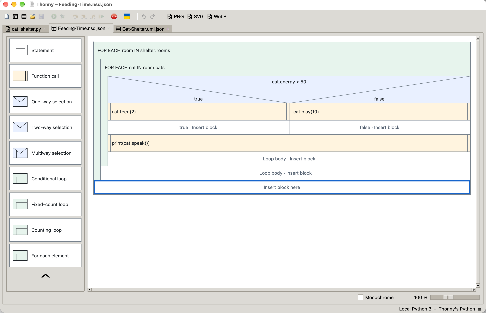
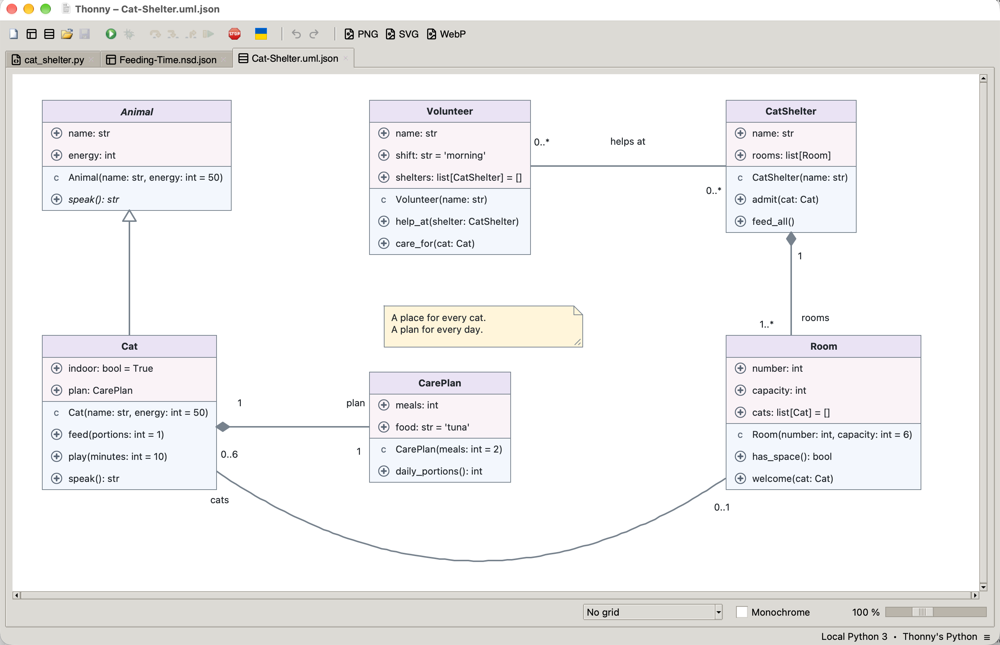
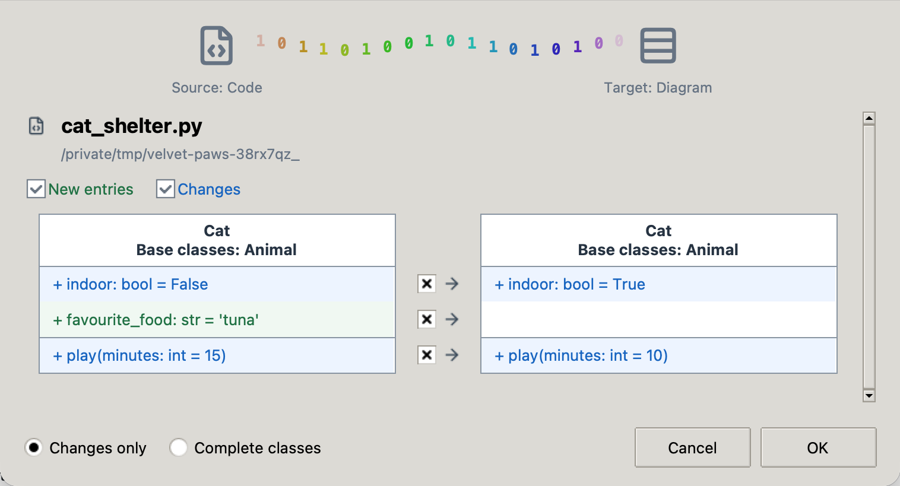
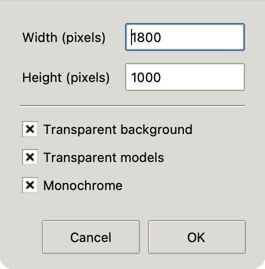
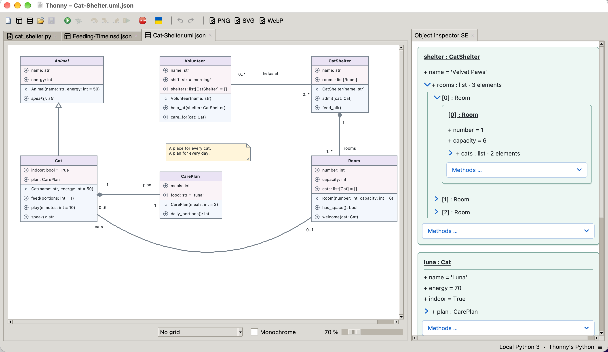
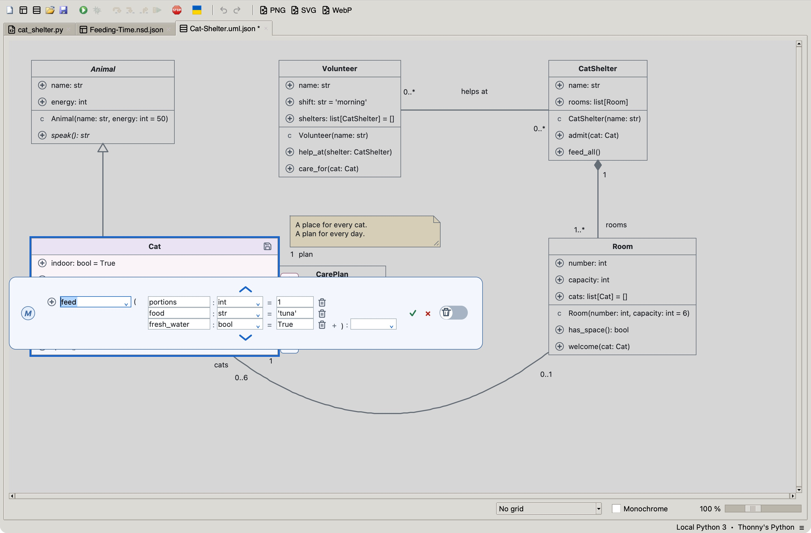

# Thonny SE

[English](README.md) · Deutsch

Plane deine Software direkt in Thonny. Mit Struktogrammen, UML und einer interaktiven Objektbank. Einfach zugänglich, damit du dich auf deine Ideen konzentrieren kannst.

## Inhalt

[Features](#das-kannst-du-damit-machen) · [Voraussetzungen](#das-brauchst-du) · [Einstieg](#so-legst-du-los) · [Manual](MANUAL.de.md) · [Geplante Funktionen](#geplante-funktionen) · [Schulischer Bezug](#schulischer-bezug) · [Technische Featureliste](#technische-features)

## Das kannst du damit machen

- `Abläufe mit Struktogrammen planen` – Modelliere Algorithmen als Nassi-Shneiderman-Diagramme mit Anweisungen, Verzweigungen und Schleifen. Verschiebe und bearbeite die Bausteine so, wie du sie brauchst.

  

- `Klassen entwerfen` – Entwirf UML-Klassendiagramme mit Attributen, Methoden und Sichtbarkeiten. Modelliere Beziehungen wie Vererbung oder Komposition und ergänze Rollen sowie Kardinalitäten/Multiplizitäten.

  

- `Zwischen Modell und Code wechseln` – Erzeuge Python-Code aus deinen Diagrammen oder Diagramme aus deinem Code. Bei verknüpften Klassen entscheidest du, welche Änderungen du übernimmst.

  

- `Diagramme mitnehmen` – Speichere deine Entwürfe als PNG, SVG oder WebP. Für dein Arbeitsblatt, deine Präsentation oder deine Dokumentation.

  

- `Objekte ausprobieren` – Erzeuge Objekte aus deinen UML-Klassen. Schau dir ihre Werte an, rufe Methoden auf und klappe Listen und Unterobjekte auf.

  

- `Angenehm lernen und präsentieren` – Vertraute Steuerung, eine übersichtliche Oberfläche und eine klare Darstellung helfen dir, dich auf deine Inhalte zu konzentrieren. Auch auf mehreren Displays mit unterschiedlichen Skalierungen soll alles scharf und gut bedienbar bleiben – beim Lernen, Erklären und Präsentieren.

  

- `Katzen`

  


## Das brauchst du

Thonny 5.0.x und Python ab 3.10.

Getestet auf macOS und Windows. Auch unter Linux lauffähig. Rückmeldungen zur Nutzung unter Linux sind willkommen.

Thonny SE wird aktiv entwickelt.

## Ausgangsbasis der Dateiformate

Version 1.0.1 legt für UML-Diagramme die Formatversion 1 fest. Struktogramme verwenden bereits Formatversion 1. Interne UML-Vorversionsformate und die alte Endung `.tse.json` werden nicht mehr unterstützt.

Mit 1.0.0 gespeicherte UML-Dateien enthalten `"version": 13`. Vor dem Öffnen mit 1.0.1 muss dieser Eintrag in der JSON-Datei **manuell auf `"version": 1` geändert werden**. Bei Dateien mit der aktuellen strukturierten Datenform sind keine weiteren Änderungen nötig. Es wird ausschließlich Formatversion 1 akzeptiert; die vollständige Dateistruktur wird weiterhin geprüft. Ältere Entwicklungsstrukturen und UML-Freitextzeilen werden nicht unterstützt. Es wird kein Konverter bereitgestellt.

## So legst du los

Die Installation über PyPI und der Wheel-Download auf GitHub stehen mit der Veröffentlichung bereit.

[Wheel für 1.0.1 herunterladen](https://github.com/mydump/Thonny-SE/releases/download/v1.0.1/thonny_se-1.0.1-py3-none-any.whl) · [Alle Releases](https://github.com/mydump/Thonny-SE/releases)

### Über Thonnys Pluginmanager

1. Öffne in Thonny `Werkzeuge → Verwalte Plug-ins ...`.
2. Suche nach `thonny-se`.
3. Wähle das Plugin und klicke auf `Installieren`.

### Mit einer Wheel-Datei von GitHub

1. Lade die Datei mit der Endung `.whl` aus den [GitHub-Releases](https://github.com/mydump/Thonny-SE/releases) herunter.
2. Öffne in Thonny `Werkzeuge → Verwalte Plug-ins ...`.
3. Wähle `Installieren mit lokalen Dateien` und öffne die heruntergeladene Wheel-Datei.

Starte Thonny nach der Installation neu.

Unter `Datei` legst du ein `neues Struktogramm` oder ein `neues UML-Diagramm` an. Unter `Ansicht → Objektinspektor SE` öffnest du die Objektbank.

### Installation im Schulnetz

Viele Schulen nutzen einen Proxy-Server für den Internetzugang. Thonny 5.0 bietet dafür kein eigenes Eingabefeld in den Einstellungen. Ohne passenden Proxy kann die Installation scheitern. Das betrifft auch eine lokale Wheel-Datei, wenn noch Abhängigkeiten heruntergeladen werden müssen.

<details>
<summary>Proxy für die Installation einstellen</summary>

Öffne in Thonny `Werkzeuge → System Terminal öffnen ...` und gib dort diesen Befehl ein:

```sh
pip config --user set global.proxy http://proxy.schule.de:8080
```

Ersetze die Beispieladresse und den Port durch die Angaben deiner Schule. Die Einstellung wird dauerhaft für den aktuellen Benutzer gespeichert und gilt auch für spätere pip-Aufrufe.

Installiere das Plugin danach über den Pluginmanager oder die Wheel-Datei.

</details>

## Erwecke deine Klassen zum Leben

Führe deinen UML-Entwurf aus und probiere seine Objekte aus. Eine eigene Python-Datei brauchst du dafür noch nicht. Das [Manual](MANUAL.de.md) zeigt dir den Einstieg und erklärt das Zusammenspiel von Diagramm, Code und Objektbank.

## Geplante Funktionen

Diese Funktionen sollen in weiteren Versionen ergänzt werden:

- **Weitere Sprachen:** Die Benutzeroberfläche über Deutsch und Englisch hinaus übersetzen.
- **Dark Mode:** Dunkle Thonny-Themes durchgängig unterstützen, einschließlich Diagrammen, Bearbeitungsbereichen und Objektbank.

## Deine Rückmeldung hilft

Du hast einen Fehler gefunden oder eine Idee? Erstelle ein [GitHub-Issue](https://github.com/mydump/Thonny-SE/issues). Nenne bei Fehlern deine Thonny-Version, dein Betriebssystem und die Schritte zum Nachstellen des Fehlers.

## Schulischer Bezug

Die schulischen Anforderungen an Thonny SE orientieren sich an den Rahmenplänen Mecklenburg-Vorpommerns und den Tafelwerkergänzungen.

- [Rahmenpläne für Informatik und Medienbildung in Mecklenburg-Vorpommern](https://www.bildung-mv.de/unterricht/rahmenplaene/rahmenplaene-fuer-die-allgemein-bildenden-faecher/informatik-und-medienbildung/)
- [Tafelwerkergänzungen auf „Informatik in der Schule MV“](https://schule.informatik.uni-rostock.de/course/view.php?id=87)

Stand 9. November 2026.

## Technische Features

### Struktogrammeditor

- Nassi-Shneiderman-Diagramme mit verschachtelten Bausteinen.
- Anweisungen, Funktionsaufrufe, ein-, zwei- und mehrseitige Auswahl.
- SOLANGE-Schleifen, feste Wiederholungsanzahl, Zählschleifen und Für-jedes-Schleifen.
- Umschaltbare einfache und vollständige Bausteinpalette.
- Bausteine aktivieren und deaktivieren. Deaktivierte Teilbäume bleiben im Entwurf erhalten und werden beim Python- und Grafikexport ausgelassen.
- Drag-and-drop, Gesamt- und zusammenhängende Mehrfachauswahl sowie Zwischenablage, auch zwischen Diagramm-Tabs.
- Rückgängig/Wiederholen, Zoom und Scrollen sowie Tastaturnavigation und Tastaturbearbeitung.
- Python-Import aus dem gesamten Editorinhalt oder einer Textauswahl. Nicht strukturell unterstützte Konstrukte werden als Codeblöcke übernommen.
- Python-Export des gesamten Diagramms oder einer Bausteinauswahl. Nicht ausführbare Anweisungstexte werden als Kommentare übernommen, Kontrollausdrücke werden geprüft.
- Monochrome Ansicht.
- Lesbares, textbasiertes JSON-Dateiformat.
- Unkomplizierter PNG-, SVG- und WebP-Export mit einstellbarer Rasterauflösung, Transparenz und monochromer Ausgabe.

### UML-Klasseneditor

- Klassen, abstrakte Klassen und Interfaces.
- Attribute mit Sichtbarkeit, Typ und optionalem Startwert.
- Methoden mit Sichtbarkeit, Parametern, Parametertypen, Standardwerten und Rückgabetyp.
- Konstruktorparameter und optionale Darstellung des Konstruktors unter dem Klassennamen.
- Getter-/Setter-Erzeugung für Attribute.
- Optionale statische Prüfung bekannter Typnamen.
- Assoziation, gerichtete Assoziation, Aggregation, Komposition, Vererbung und Interface-Realisierung.
- Rollen, Kardinalitäten/Multiplizitäten und Beziehungsnamen.
- Selbstbeziehungen für Assoziation, Aggregation und Komposition mit eigenen Rollen und Kardinalitäten/Multiplizitäten.
- Frei positionierbare Klassenkarten und manuell verformbare Beziehungslinien.
- Gemeinsames Auswählen und Verschieben mehrerer Klassen sowie Kopieren zwischen Diagrammen, einschließlich interner Beziehungen und angehefteter Kommentare.
- Optionales sichtbares oder magnetisches Raster zum Einrasten der Klassen.
- Verschiebbare und skalierbare Kommentare mit optionaler Klassenzuordnung.
- Python-Import aus dem aktuellen Editor, einzelnen Dateien oder allen Python-Dateien eines Ordners ohne Unterordner.
- Beziehungserkennung aus Basisklassen und Attributtypen.
- Python-Codegenerierung für einzelne Klassen oder das gesamte Diagramm.
- Persistente Quellenzuordnung und expliziter Abgleich in beide Richtungen, einzeln oder klassenübergreifend.
- Änderungsvorschau mit Einzel- und Gruppenauswahl sowie Konfliktbehandlung.
- Erhalt vorhandener Methodenimplementierungen bei Signaturänderungen.
- Navigation zur verknüpften Klassen-, Methoden- oder Attributdefinition im Python-Code.
- Ausführung des aktuellen Diagrammstands über Thonnys Befehl `Ausführen` / <kbd>F5</kbd>, ohne vorheriges Speichern oder eigene Python-Datei.
- Rückgängig/Wiederholen, Zoom und Scrollen.
- Lesbares, textbasiertes JSON-Dateiformat.
- Unkomplizierter PNG-, SVG- und WebP-Export mit einstellbarer Rasterauflösung, Transparenz und monochromer Ausgabe.

### Objektbank

- Instanziierung von UML-Klassen nach erfolgreicher Ausführung des Diagrammstands. Nach codewirksamen Änderungen ist für neue Objekte eine erneute Ausführung nötig.
- Eingabe der Werte für die Parameter mit Pflichtangaben, Standardwerten, Typangaben und Auswahl vorhandener Objekte.
- Darstellung benannter Instanzen mit Klasse, Attributwerten und Methoden.
- Methodenaufrufe mit Ergebnis- und Fehleranzeige sowie Unterstützung zum Unterbrechen laufender Aufrufe.
- Aktualisierung der Objektzustände nach abgeschlossenen Ausführungen und Methodenaufrufen.
- Aufklappbare Listen, Tupel, Dictionaries, Sets und Frozensets.
- Schrittweises Nachladen größerer Sammlungen.
- Darstellung referenzierter Unterobjekte als eingerückte Objektkarten mit aufrufbaren Methoden.
- Kennzeichnung gemeinsamer Objektidentitäten und zyklischer Referenzen.
- Erhalt geöffneter Zweige bei Zustandsaktualisierungen.
- Umschaltbare Methodendarstellung als Auswahlliste oder einzelne Schaltflächen.
- Kennzeichnung von Abweichungen zwischen geladenem Programmstand und UML-Entwurf.
- Bestehende Objekte bleiben nach Entwurfsänderungen verfügbar. Erneutes Ausführen startet die Objektsitzung neu.
