# Thonny SE

English · [Deutsch](https://github.com/mydump/Thonny-SE/blob/main/README.de.md)

Design your software right in Thonny. With structured flowcharts, UML and an interactive object bench. Easy to get into, so you can focus on your ideas.

## Contents

[Features](#what-you-can-do) · [Requirements](#what-you-need) · [Getting started](#get-started) · [Manual](https://github.com/mydump/Thonny-SE/blob/v1.0.1/MANUAL.md) · [Educational references](#educational-references) · [Technical feature list](#technical-features)

## What you can do

`Plan algorithms with structograms` – Model algorithms as Nassi–Shneiderman diagrams with statements, branches and loops. Move and edit the blocks to suit your plan.

| Light | Dark |
| --- | --- |
| <a href="images/readme/01-structogram.png?raw=true">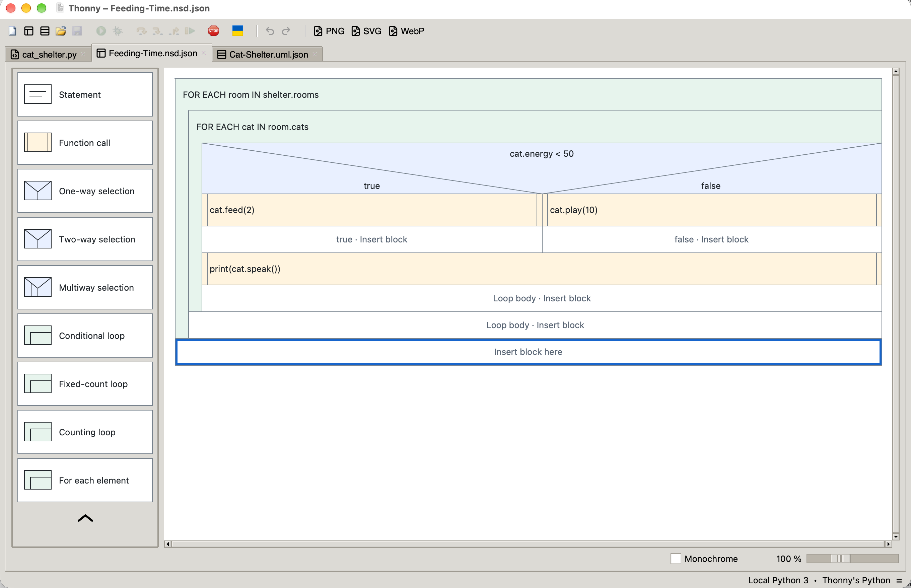</a> | <a href="images/readme/01-structogram-dark.png?raw=true">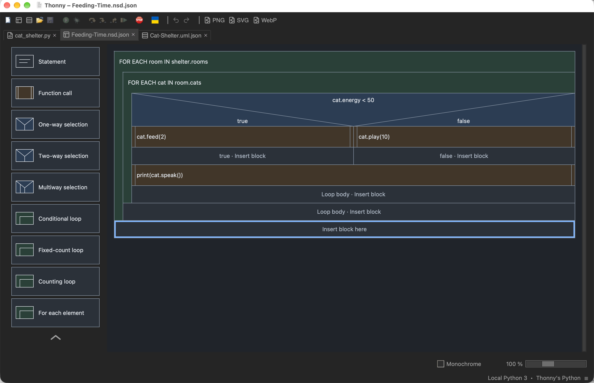</a> |

`Design your classes` – Design UML class diagrams with attributes, methods and visibility. Model relationships such as inheritance or composition, and add roles and multiplicities.

| Light | Dark |
| --- | --- |
| <a href="images/readme/02-uml.png?raw=true">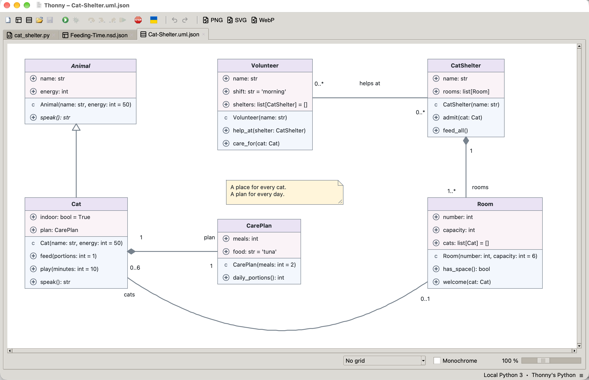</a> | <a href="images/readme/02-uml-dark.png?raw=true">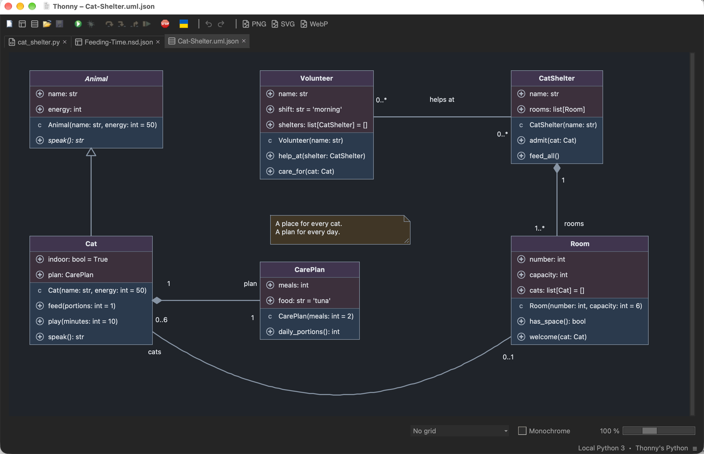</a> |

`Move between models and code` – Turn your diagrams into Python code or your code into diagrams. For linked classes, you choose which changes to apply.

| Light | Dark |
| --- | --- |
| <a href="images/readme/03-code-model.png?raw=true">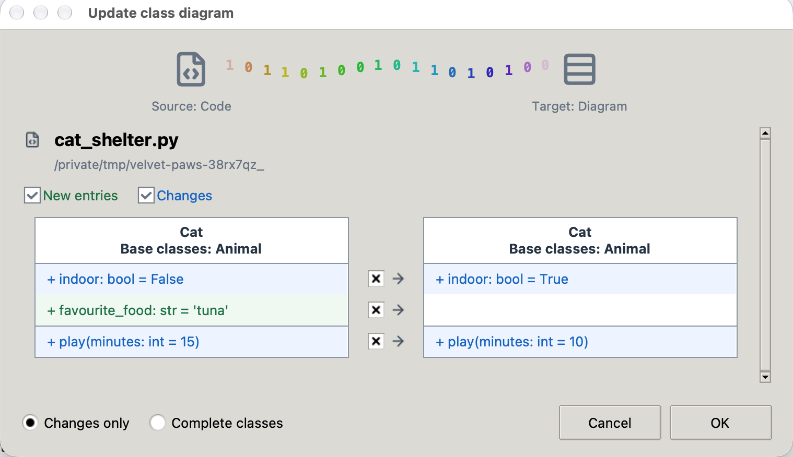</a> | <a href="images/readme/03-code-model-dark.png?raw=true">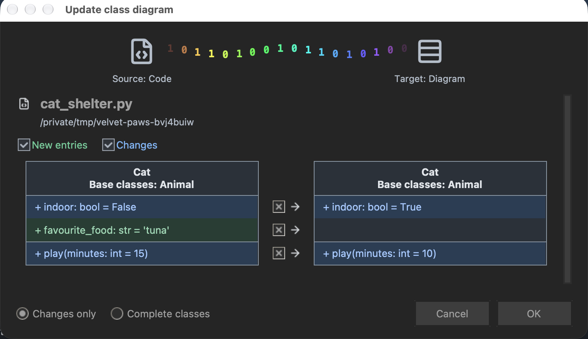</a> |

`Take your diagrams with you` – Save your designs as PNG, SVG or WebP. Ready for a worksheet, a presentation or your documentation.

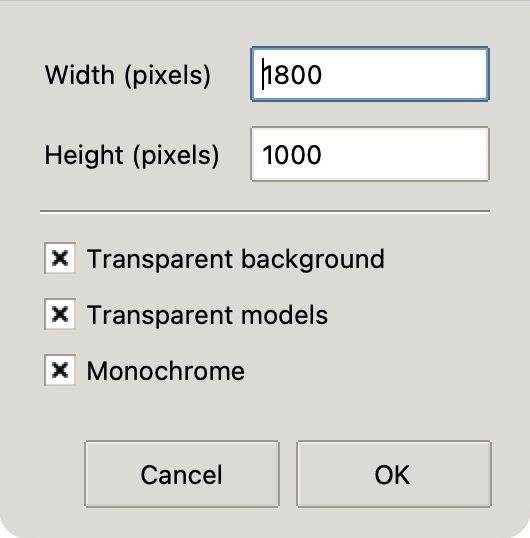

<br>


`Try your objects` – Create objects from your UML classes. Explore their values, call methods and expand lists and nested objects.

| Light | Dark |
| --- | --- |
| <a href="images/readme/05-objects.png?raw=true">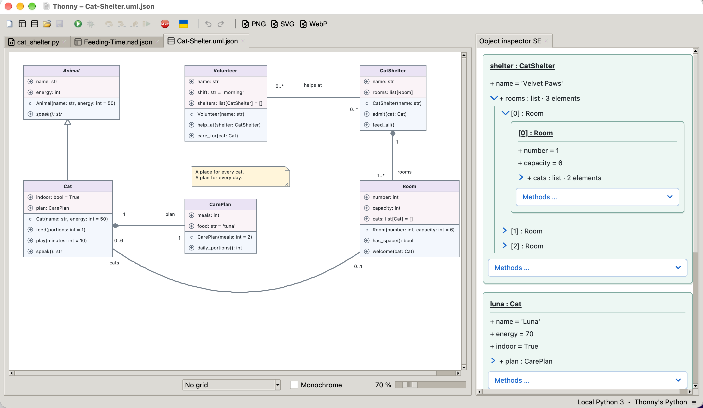</a> | <a href="images/readme/05-objects-dark.png?raw=true">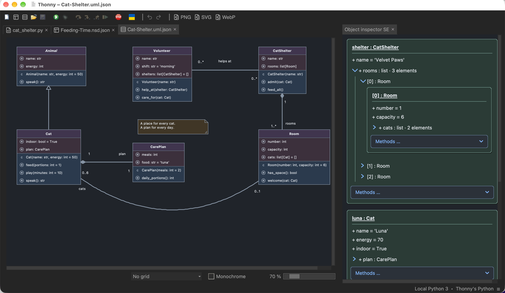</a> |

`Learn and present comfortably` – Familiar controls, an uncluttered interface and clear visuals help you focus on your content. The aim is to keep everything sharp and easy to use across multiple displays with different scaling settings – while learning, explaining and presenting. Choose a light or dark appearance for Thonny SE, including its diagrams, editing controls and object bench.

| Light | Dark |
| --- | --- |
| <a href="images/readme/06-thonny.png?raw=true">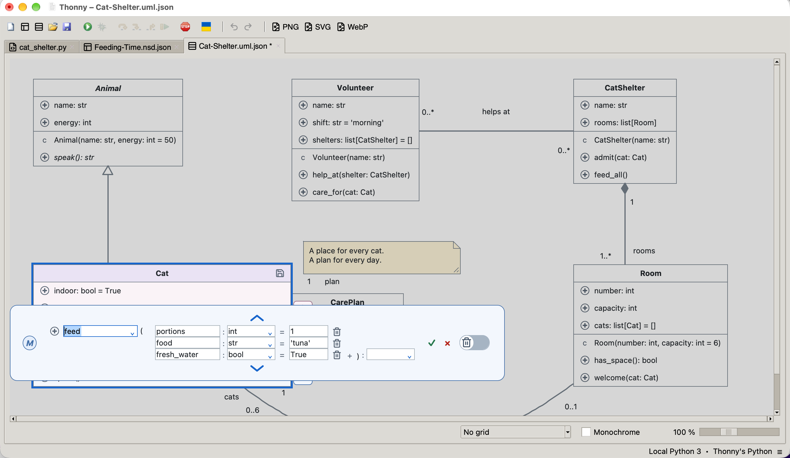</a> | <a href="images/readme/06-thonny-dark.png?raw=true">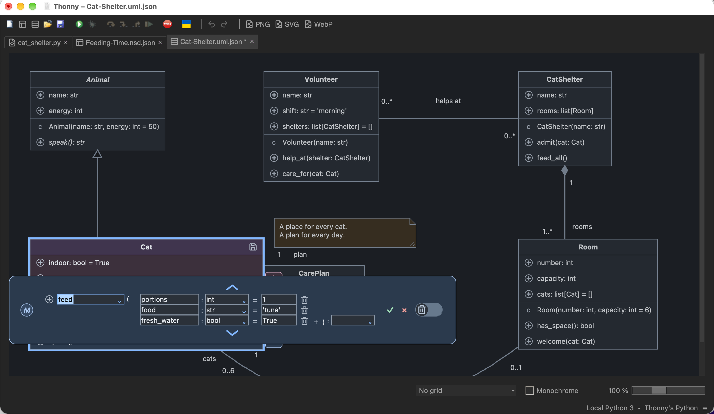</a> |

`Cats` are around too.

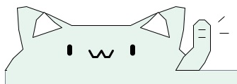


## What you need

Thonny 5.0.x and Python 3.10 or later.

Tested on macOS and Windows. Also runs on Linux. Feedback on using it on Linux is welcome.

## Get started

Install through PyPI or download a wheel from GitHub.

[Download wheel for 1.0.1](https://github.com/mydump/Thonny-SE/releases/download/v1.0.1/thonny_se-1.0.1-py3-none-any.whl) · [All releases](https://github.com/mydump/Thonny-SE/releases)

### Through Thonny’s plug-in manager

1. In Thonny, open `Tools → Manage plug-ins...`.
2. Search for `thonny-se`.
3. Select the plug-in and click `Install`.

### With a wheel file from GitHub

1. Download the file ending in `.whl` from the [GitHub releases](https://github.com/mydump/Thonny-SE/releases).
2. In Thonny, open `Tools → Manage plug-ins...`.
3. Choose `Install from local file` and open the downloaded wheel file.

Restart Thonny after installation.

Under `File`, create a `New structogram` or a `New UML diagram`. Open the object bench under `View → Object inspector SE`.

### Installing on a school network

Many schools use a proxy server for internet access. Thonny 5.0 has no dedicated proxy field in its settings. Installation can fail without the correct proxy. This also affects a local wheel file when dependencies still need to be downloaded.

<details>
<summary>Set a proxy for installation</summary>

In Thonny, open `Tools → Open system shell...` and enter this command:

```sh
pip config --user set global.proxy http://proxy.schule.de:8080
```

Replace the example address and port with the details provided by your school. The setting is saved permanently for the current user and also applies to later pip commands.

Then install the plug-in through the plug-in manager or the wheel file.

</details>

## Bring your classes to life

Run your UML design and try its objects. You do not need your own Python file yet. The [manual](https://github.com/mydump/Thonny-SE/blob/v1.0.1/MANUAL.md) walks you through getting started and explains how diagrams, code and the object bench work together.

## Your feedback helps

Found a bug or have an idea? Open a [GitHub issue](https://github.com/mydump/Thonny-SE/issues). For bugs, include your Thonny version, your operating system and the steps needed to reproduce the problem.

## Educational references

Thonny SE’s school-related requirements are informed by the curricula of Mecklenburg-Vorpommern, Germany, and the supplementary reference materials (Tafelwerkergänzungen).

- [Mecklenburg-Vorpommern curricula for computer science and media education](https://www.bildung-mv.de/unterricht/rahmenplaene/rahmenplaene-fuer-die-allgemein-bildenden-faecher/informatik-und-medienbildung/)
- [Supplementary reference materials on “Informatik in der Schule MV”](https://schule.informatik.uni-rostock.de/course/view.php?id=87)

As of 9 November 2026.

## Technical features

### Structogram editor

- Nassi–Shneiderman diagrams with nested blocks.
- Statements, function calls, one-way and two-way selection, and multi-way selection.
- While loops, fixed repetition counts, counting loops and for-each loops.
- Switchable basic and full block palettes.
- Activation and deactivation of blocks. Deactivated subtrees stay in the design and are omitted from Python and image exports.
- Drag-and-drop, select all, contiguous multi-selection and clipboard operations, including between diagram tabs.
- Undo/redo, zoom and scrolling, plus keyboard navigation and keyboard editing.
- Python import from the full editor content or a text selection. Constructs without a structural representation are retained as code blocks.
- Python export of the full diagram or selected blocks. Non-executable statement text is retained as comments, while control expressions are validated.
- Monochrome display.
- Readable, text-based JSON file format.
- Straightforward PNG, SVG and WebP export with configurable raster resolution, transparency and monochrome output.

### UML class editor

- Classes, abstract classes and interfaces.
- Attributes with visibility, type and optional initial value.
- Methods with visibility, parameters, parameter types, default values and return type.
- Constructor parameters and optional display of the constructor using the class name.
- Getter/setter generation for attributes.
- Optional static validation of known type names.
- Association, directed association, aggregation, composition, inheritance and interface realization.
- Roles, multiplicities and relationship names.
- Self-relationships for association, aggregation and composition, with separate roles and multiplicities.
- Freely positioned class cards and manually adjustable relationship curves.
- Group selection and movement of classes, plus copying between diagrams with internal relationships and attached comments.
- Optional visual or magnetic grid for snapping class positions.
- Movable, resizable comments with optional class attachment.
- Python import from the current editor, individual files or all Python files in a folder, excluding subfolders.
- Relationship inference from base classes and attribute types.
- Python code generation for individual classes or the entire diagram.
- Persistent source links and explicit updates in both directions, individually or across multiple classes.
- Change preview with individual and group selection and conflict handling.
- Preservation of existing method implementations when updating signatures.
- Navigation to the linked class, method or attribute definition in Python code.
- Execution of the current diagram state using Thonny’s `Run` command / <kbd>F5</kbd>, without saving first or creating a Python file.
- Undo/redo, zoom and scrolling.
- Readable, text-based JSON file format.
- Straightforward PNG, SVG and WebP export with configurable raster resolution, transparency and monochrome output.

### Object bench

- Instantiation of UML classes after successful execution of the diagram. After code-affecting changes, run the diagram again before creating new objects.
- Entry of parameter values with required fields, defaults, type information and selection of existing objects.
- Named instances displayed with their class, attribute values and methods.
- Method calls with result and error display, and support for interrupting running calls.
- Object state updates after completed executions and method calls.
- Expandable lists, tuples, dictionaries, sets and frozensets.
- Incremental loading of larger collections.
- Referenced nested objects displayed as indented object cards with callable methods.
- Indication of shared object identities and cyclic references.
- Preservation of expanded branches during state updates.
- Method display selectable between a drop-down list and individual buttons.
- Indication of differences between the loaded program state and the UML design.
- Existing objects remain available after design changes. Running the diagram again restarts the object session.
